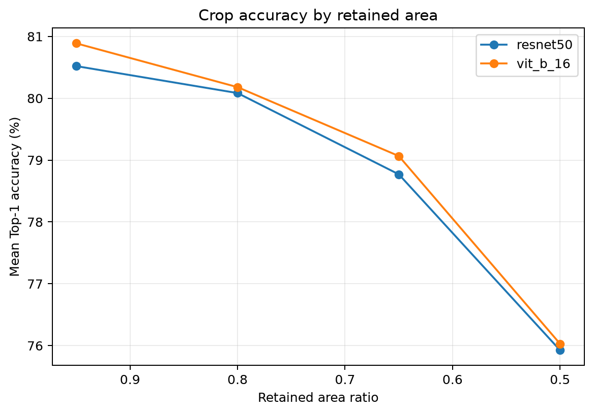
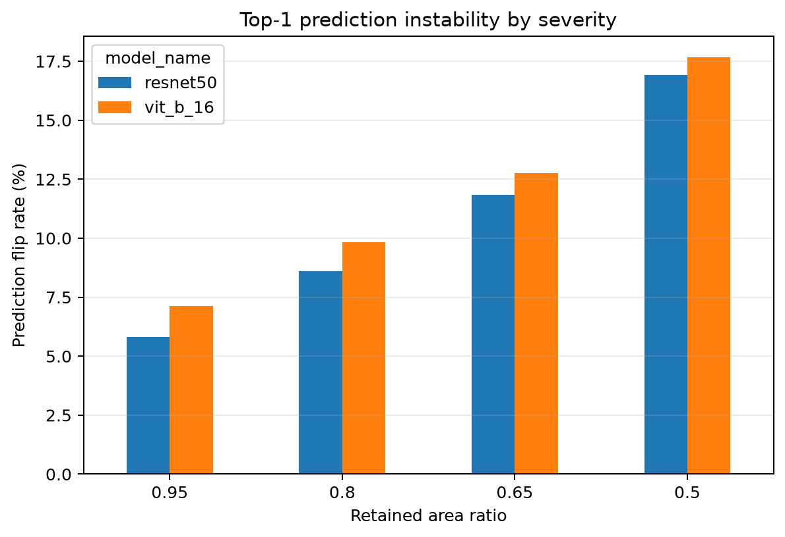
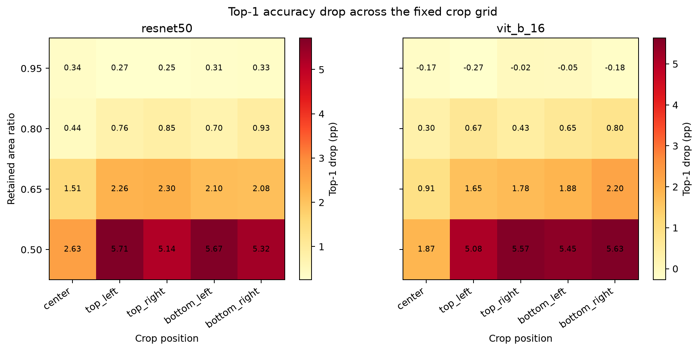
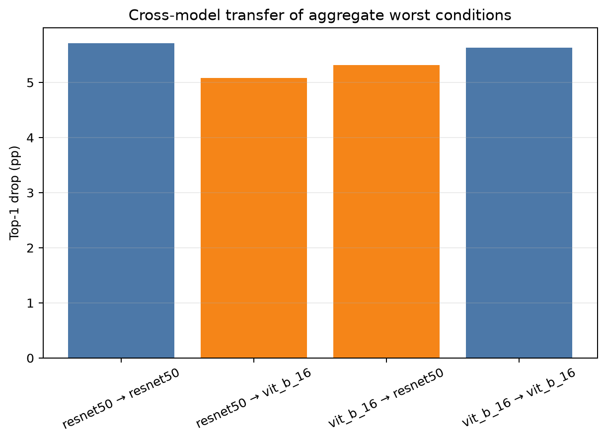

# Adversarial Cropping: So sánh độ bền vững của ResNet-50 và ViT-B/16

## 1. Bối cảnh và hướng triển khai chung

Project **“What Do Vision Transformers See That CNNs Do Not?”** nghiên cứu và
so sánh cách hai kiến trúc **CNN (Convolutional Neural Network)** và **ViT
(Vision Transformer)** xử lý thông tin hình ảnh. Các thí nghiệm của project được
chia thành ba hướng chính: khả năng diễn giải mô hình (interpretability), độ bền
vững trước biến đổi đầu vào (robustness), và phân tích biểu diễn đặc trưng
(representation analysis).

Phần việc này tập trung vào **Adversarial Cropping**, một thí nghiệm robustness
nhằm trả lời ba câu hỏi:

1. Khi một phần nội dung ảnh bị cắt bỏ, độ chính xác của ResNet-50 và ViT-B/16
   giảm như thế nào?
2. Hai mô hình có nhạy với cùng mức độ và vị trí crop hay không?
3. Crop gây ảnh hưởng mạnh nhất cho một mô hình có đồng thời gây ảnh hưởng mạnh
   cho mô hình còn lại hay không?

Trong phạm vi thí nghiệm này, “adversarial crop” là crop tệ nhất được chọn từ
một **tập 20 ứng viên cố định**. Đây là một finite grid search có kiểm soát,
không phải gradient-based adversarial attack và không tối ưu crop riêng cho từng
ảnh.

---

## 2. Methodology

### 2.1. Dữ liệu và cohort

Thí nghiệm sử dụng tập validation của **ImageNet-1K** được lưu cục bộ dưới dạng
14 Parquet shards. Từ tập validation, project sử dụng manifest chung
`analysis_10000_seed42.csv`, gồm:

- 10.000 ảnh;
- 1.000 lớp ImageNet;
- đúng 10 ảnh cho mỗi lớp;
- cùng một danh sách `image_id` cho cả hai mô hình và mọi điều kiện crop.

Không resample dữ liệu riêng cho từng mô hình hoặc từng condition. Mọi phép ghép
giữa clean prediction và cropped prediction đều được thực hiện bằng `image_id`,
không dựa vào thứ tự các dòng trong CSV.

### 2.2. Mô hình

Hai mô hình pretrained có độ chính xác baseline gần tương đương được sử dụng:

| Mô hình | Kiến trúc | Weights |
| --- | --- | --- |
| ResNet-50 | Convolutional Neural Network | `IMAGENET1K_V2` |
| ViT-B/16 | Vision Transformer, patch size 16 | `IMAGENET1K_V1` |

Mô hình được load qua API dùng chung `src.models.load_model`. Không fine-tune
hoặc train lại. Mỗi mô hình sử dụng official preprocessing đi kèm weights:

- ResNet-50: resize cạnh ngắn về 232, sau đó center crop 224 × 224;
- ViT-B/16: resize cạnh ngắn về 256, sau đó center crop 224 × 224;
- cả hai dùng ảnh RGB, bilinear interpolation và ImageNet normalization.

Crop luôn được thực hiện **trên ảnh PIL RGB gốc trước preprocessing**:

```text
Ảnh RGB gốc → crop cố định → official transform của model → model prediction
```

### 2.3. Thiết kế crop grid

Thí nghiệm sử dụng bốn tỷ lệ diện tích ảnh được giữ lại:

- 95%;
- 80%;
- 65%;
- 50%.

Với ảnh gốc có kích thước `W × H` và tỷ lệ giữ lại `q`, kích thước crop được
tính theo:

```text
crop_width  = round(W × sqrt(q))
crop_height = round(H × sqrt(q))
```

Cách tính này giữ nguyên tỷ lệ khung hình và làm cho diện tích crop xấp xỉ
`q × W × H`. Sai khác nhỏ có thể xuất hiện do làm tròn về số pixel nguyên.

Mỗi mức diện tích được áp dụng tại năm vị trí:

- `center`;
- `top_left`;
- `top_right`;
- `bottom_left`;
- `bottom_right`.

Tọa độ crop dùng quy ước `(left, top, right, bottom)`, trong đó `right` và
`bottom` là exclusive. Kết hợp bốn mức diện tích và năm vị trí tạo ra **20 crop
conditions cho mỗi ảnh**. Hai mô hình nhận chính xác cùng ảnh, cùng condition và
cùng tọa độ crop.

### 2.4. Các giai đoạn thực hiện

Quá trình được chia thành năm giai đoạn để hạn chế lỗi và bảo đảm khả năng tái
lập:

1. **Phase 0 – Audit và chốt thiết kế:** kiểm tra 14 Parquet shards, manifest
   10.000 ảnh, baseline CSV 50.000 ảnh, model checkpoints, API dùng chung và
   chốt toàn bộ methodology.
2. **Phase 1 – Crop utility:** hiện thực crop deterministic, kiểm tra RGB mode,
   kích thước, bounds, tọa độ, realized area ratio và tính lặp lại trên ảnh thật.
3. **Phase 2 – Clean baseline:** lọc baseline 50.000 ảnh về đúng 10.000 `image_id`
   trong cohort và tính lại clean accuracy. Không lấy trực tiếp full-50K accuracy
   làm reference.
4. **Phase 3 – Pilot/smoke test:** chạy cohort nhỏ trước để kiểm tra schema,
   label consistency, ID pairing, điều kiện crop, memory và khả năng resume.
5. **Phase 4 – Main run:** chạy toàn bộ 10.000 ảnh trên GPU, lưu checkpoint theo
   chunk và chỉ công bố thư mục `final/` sau khi validation thành công.

Main run sử dụng CUDA, batch size 32 và chunk size 1.000 ảnh. Không lưu raw
images hoặc cropped images. Output hoàn chỉnh gồm 210.000 prediction rows cho
mỗi model (10.000 clean + 200.000 crop), 200.000 dòng crop parameters và 40 dòng
condition-level metrics.

### 2.5. Metrics

Các metric được tính trên cùng 10.000 `image_id`:

- **Top-1 accuracy:** nhãn đúng là dự đoán có xác suất cao nhất.
- **Top-5 accuracy:** nhãn đúng xuất hiện trong năm dự đoán có xác suất cao nhất.
- **Absolute accuracy drop (pp):** `clean accuracy − cropped accuracy`, đo bằng
  điểm phần trăm.
- **Relative accuracy drop (%):**
  `100 × (clean accuracy − cropped accuracy) / clean accuracy`.
- **Prediction flip rate (%):** tỷ lệ ảnh có Top-1 prediction sau crop khác với
  Top-1 prediction clean, bất kể dự đoán đó đúng hay sai.

Ví dụ, accuracy giảm từ 80% xuống 75% tương ứng với giảm **5 điểm phần trăm**,
nhưng relative drop là **6,25%**. Hai đại lượng này không được dùng thay thế cho
nhau.

---

## 3. Results

### 3.1. Clean baseline trên analysis cohort

Hai mô hình có clean accuracy gần như bằng nhau trên cùng 10.000 ảnh:

| Mô hình | Clean Top-1 | Clean Top-5 |
| --- | ---: | ---: |
| ResNet-50 | 80,82% | 95,40% |
| ViT-B/16 | 80,75% | 95,31% |

Chênh lệch clean Top-1 chỉ là 0,07 điểm phần trăm. Vì vậy, thay đổi sau crop có
thể được so sánh trực tiếp mà ít bị chi phối bởi chênh lệch baseline ban đầu.

### 3.2. Accuracy giảm khi diện tích giữ lại nhỏ hơn

Bảng dưới đây lấy trung bình trên năm vị trí crop tại mỗi severity:

| Model | Diện tích giữ lại | Top-1 sau crop | Giảm Top-1 | Relative drop | Flip rate |
| --- | ---: | ---: | ---: | ---: | ---: |
| ResNet-50 | 95% | 80,52% | 0,30 pp | 0,37% | 5,82% |
| ResNet-50 | 80% | 80,08% | 0,74 pp | 0,91% | 8,60% |
| ResNet-50 | 65% | 78,77% | 2,05 pp | 2,54% | 11,83% |
| ResNet-50 | 50% | 75,93% | 4,89 pp | 6,06% | 16,92% |
| ViT-B/16 | 95% | 80,89% | -0,14 pp | -0,17% | 7,13% |
| ViT-B/16 | 80% | 80,18% | 0,57 pp | 0,71% | 9,83% |
| ViT-B/16 | 65% | 79,07% | 1,68 pp | 2,09% | 12,75% |
| ViT-B/16 | 50% | 76,03% | 4,72 pp | 5,85% | 17,67% |



**Hình 1.** Top-1 accuracy trung bình trên năm vị trí. Cả hai đường giảm rõ rệt
khi diện tích giữ lại giảm từ 95% xuống 50%, và hai mô hình có xu hướng rất gần
nhau.

Khi chỉ giữ 50% diện tích ảnh, ResNet-50 giảm từ 80,82% xuống 75,93%, còn
ViT-B/16 giảm từ 80,75% xuống 76,03%. ViT-B/16 có mức giảm Top-1 thấp hơn
ResNet-50 khoảng 0,17 điểm phần trăm, nhưng mức chênh lệch này nhỏ và chưa đủ để
kết luận ViT vượt trội rõ rệt về crop robustness.

### 3.3. Prediction thay đổi ngay cả khi accuracy chưa giảm mạnh



**Hình 2.** Tỷ lệ Top-1 prediction bị thay đổi sau crop. Flip rate tăng đều khi
crop mạnh hơn và đạt 16,92% với ResNet-50, 17,67% với ViT-B/16 ở mức giữ 50%.

Tại mức giữ 95%, Top-1 accuracy của ViT-B/16 tăng nhẹ 0,14 điểm phần trăm nhưng
flip rate vẫn là 7,13%. Điều này cho thấy prediction flip và accuracy drop đo hai
khía cạnh khác nhau: một số dự đoán đúng có thể trở thành sai, đồng thời một số
dự đoán sai ban đầu có thể trở thành đúng.

### 3.4. Ảnh hưởng của vị trí crop



**Hình 3.** Mức giảm Top-1 theo từng cặp severity–position. Màu đậm hơn thể hiện
accuracy drop lớn hơn.

Center crop ổn định hơn các crop ở góc, đặc biệt ở mức giữ lại 50%:

- ResNet-50 giảm 2,63 pp với center, nhưng giảm 5,71 pp với top-left;
- ViT-B/16 giảm 1,87 pp với center, nhưng giảm 5,63 pp với bottom-right.

Điều này phù hợp với đặc điểm của ImageNet: đối tượng chính thường nằm gần trung
tâm ảnh. Center crop có xu hướng giữ lại đối tượng, trong khi corner crop dễ loại
bỏ phần quan trọng của vật thể.

### 3.5. Worst condition và cross-model transfer

Worst aggregate condition của hai mô hình không hoàn toàn giống nhau:

| Model dùng để chọn condition | Worst condition | Top-1 sau crop | Giảm Top-1 |
| --- | --- | ---: | ---: |
| ResNet-50 | Giữ 50%, top-left | 75,11% | 5,71 pp |
| ViT-B/16 | Giữ 50%, bottom-right | 75,12% | 5,63 pp |



**Hình 4.** Crop tệ nhất được chọn bởi một mô hình vẫn gây giảm accuracy mạnh
khi chuyển sang mô hình còn lại.

Crop top-left do ResNet-50 chọn làm ViT-B/16 giảm 5,08 pp. Crop bottom-right do
ViT-B/16 chọn làm ResNet-50 giảm 5,32 pp. Như vậy, dù worst position khác nhau,
hai mô hình vẫn chia sẻ mức độ nhạy đáng kể với việc mất context ở các góc ảnh.

---

## 4. Discussion

### 4.1. Điểm giống nhau giữa CNN và ViT

Kết quả nổi bật nhất là hai mô hình có xu hướng robustness rất giống nhau. Khi
diện tích ảnh giảm, Top-1 accuracy của cả ResNet-50 và ViT-B/16 đều giảm gần như
song song. Tại mức giữ 50%, chênh lệch accuracy giữa hai model chỉ khoảng 0,10
điểm phần trăm. Vì vậy, trong fixed crop grid này, chưa có bằng chứng cho thấy
một kiến trúc có lợi thế lớn và nhất quán hơn kiến trúc còn lại.

Hai mô hình cũng đều ổn định hơn với center crop và nhạy hơn với corner crop.
Điều này gợi ý rằng cả CNN và ViT đều phụ thuộc đáng kể vào vị trí của đối tượng
và lượng context còn lại, dù cơ chế xử lý nội bộ của chúng khác nhau.

### 4.2. Điểm khác nhau

ViT-B/16 có accuracy drop trung bình thấp hơn ResNet-50 một lượng nhỏ ở cả ba
mức 80%, 65% và 50%. Tuy nhiên, ViT-B/16 lại có prediction flip rate cao hơn ở
cả bốn severity. Một cách diễn giải thận trọng là ViT có thể thay đổi class được
dự đoán thường xuyên hơn khi trường nhìn thay đổi, trong khi tổng số dự đoán đúng
vẫn gần tương đương ResNet.

Worst position của hai model cũng khác nhau: ResNet-50 nhạy nhất với top-left,
còn ViT-B/16 nhạy nhất với bottom-right. Sự khác biệt này cho thấy hai kiến trúc
không phản ứng hoàn toàn giống nhau với vị trí thông tin bị loại bỏ. Tuy vậy,
cross-model transfer cho thấy khác biệt đó không tuyệt đối, vì worst crop của
một model vẫn làm giảm mạnh accuracy của model kia.

### 4.3. Giải thích khả dĩ

ResNet xây dựng đặc trưng từ các receptive field cục bộ rồi tổng hợp dần qua các
layer. ViT chia ảnh thành patch và dùng self-attention để trao đổi thông tin toàn
cục. Về lý thuyết, hai cơ chế này có thể dẫn đến phản ứng khác nhau khi mất một
phần ảnh. Tuy nhiên, crop trong thí nghiệm không chỉ loại bỏ pixel mà còn thay đổi
trường nhìn trước bước resize và center crop. Cả hai mô hình vì thế đều nhận một
phiên bản phóng lớn của vùng còn lại, và hiệu ứng preprocessing có thể làm giảm
khác biệt vốn có giữa hai kiến trúc.

Ngoài ra, ImageNet có center bias mạnh. Đây có thể là nguyên nhân quan trọng khiến
center crop tốt hơn corner crop cho cả hai model, thay vì chỉ phản ánh riêng cơ
chế CNN hay self-attention.

### 4.4. Hạn chế

1. Crop grid chỉ gồm bốn mức diện tích và năm vị trí cố định; chưa xét crop có
   aspect ratio khác, vị trí liên tục hoặc crop theo object bounding box.
2. “Adversarial” ở đây là worst condition trên toàn cohort, không phải attack
   gradient-based hoặc crop được tối ưu riêng cho mỗi ảnh.
3. Hai model dùng official transforms khác nhau (resize 232 và 256), nên trường
   nhìn trước center crop 224 × 224 không hoàn toàn giống nhau.
4. Các ảnh ImageNet thường đặt vật thể gần trung tâm, do đó kết quả theo vị trí
   có thể bị ảnh hưởng bởi dataset bias.
5. Thí nghiệm báo cáo point estimates trên một manifest cố định, chưa có confidence
   interval hoặc kiểm định ý nghĩa thống kê.
6. Accuracy và flip rate không chỉ ra trực tiếp vùng ảnh nào được mô hình sử dụng;
   cần kết hợp với Grad-CAM, attention map hoặc ERF để đưa ra kết luận mạnh hơn về
   cơ chế nhận biết.
7. Kết quả chỉ áp dụng cho ResNet-50 và ViT-B/16 với các weights đã chọn; không
   nên khái quát trực tiếp cho mọi CNN và mọi Vision Transformer.

### 4.5. Kết luận

Thí nghiệm cho thấy việc loại bỏ dần nội dung ảnh làm giảm rõ rệt khả năng dự
đoán của cả ResNet-50 và ViT-B/16. Khi chỉ giữ 50% diện tích, Top-1 accuracy của
cả hai giảm khoảng 4,7–4,9 điểm phần trăm và gần 17% ảnh thay đổi Top-1
prediction. Hai mô hình có hành vi tổng thể rất gần nhau, nhưng khác nhau nhẹ về
flip rate và worst crop position. Kết quả này ủng hộ nhận định rằng cả CNN và ViT
đều phụ thuộc vào context và vị trí đối tượng; fixed crop grid hiện tại chưa cho
thấy lợi thế robustness rõ ràng của một kiến trúc.

---

## 5. Tài liệu và output tái lập

- Thiết kế thí nghiệm: `docs/adversarial_cropping_decision.md`
- Crop và runner: `experiments/adversarial_cropping/`
- Notebook minh họa: `notebooks/05_adversarial_cropping.ipynb`
- Run ID: `main10000_grid_kaggle_gpu_v1_20261106_9544b43`
- Metrics: `results/metrics/experiments/adversarial_cropping/<run_id>/final/`
- Figures: `results/figures/experiments/adversarial_cropping/<run_id>/final/`

Main run đã hoàn tất với trạng thái `complete`. Các output chính được kiểm tra về
số lượng ID, label consistency, duplicate key, condition coverage và pairing
giữa hai model trước khi phân tích.
