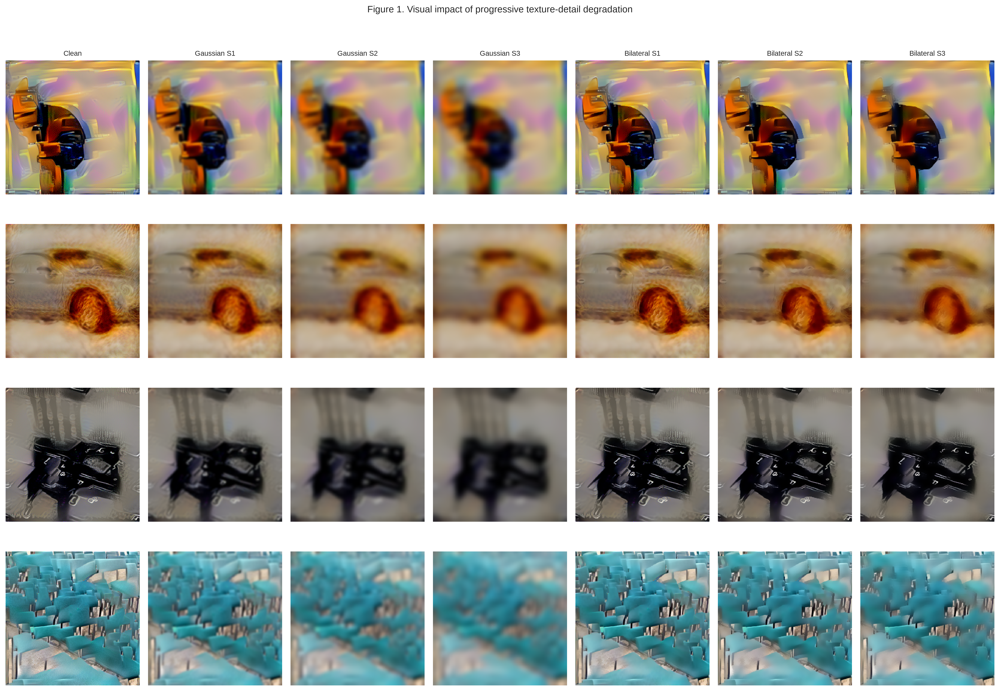
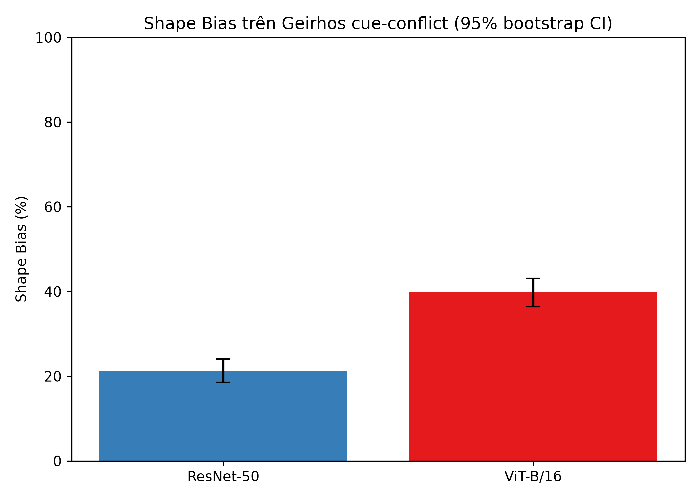
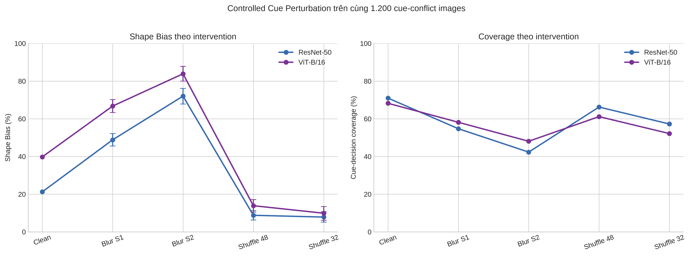
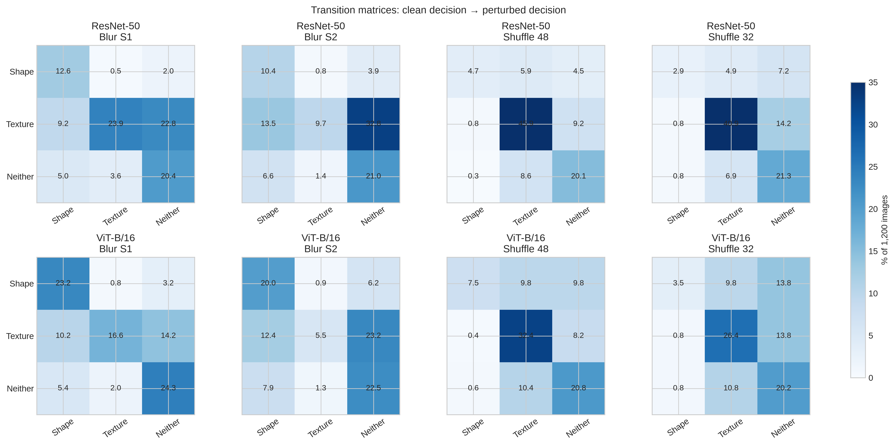
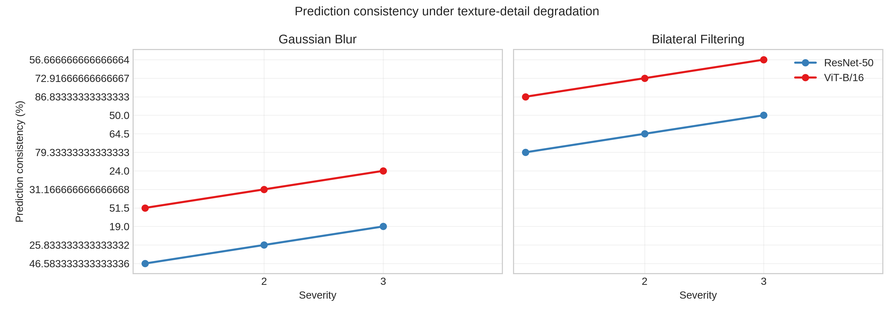
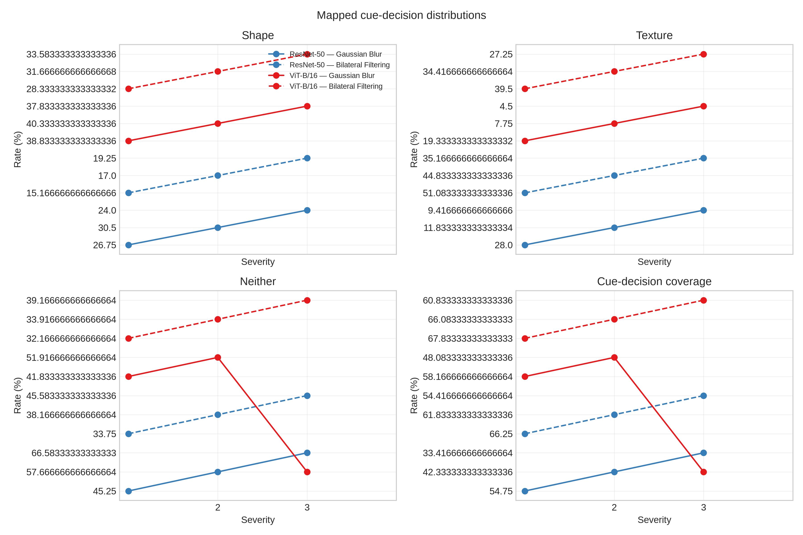
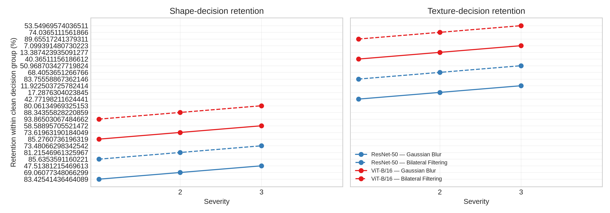
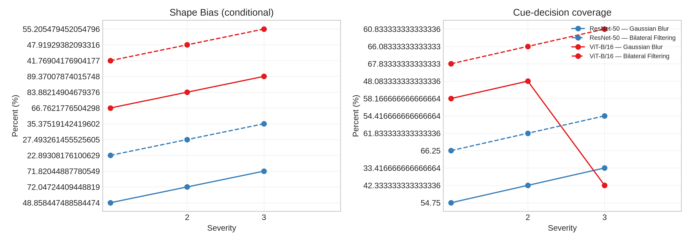

# Shape–Texture Reliance and Robustness in ResNet-50 and ViT-B/16

## Tóm tắt

Nghiên cứu này so sánh cách ResNet-50 và ViT-B/16 sử dụng tín hiệu hình dạng (*shape*) và bề mặt (*texture*) trên benchmark Texture–Shape Cue Conflict của Geirhos. Hai thí nghiệm bổ trợ được thực hiện trên cùng 1.200 ảnh có shape cue khác texture cue. Thí nghiệm thứ nhất đo Shape Bias từ quyết định mapped 16-category; thí nghiệm thứ hai đánh giá độ ổn định của quyết định khi chi tiết texture bị suy giảm bằng Gaussian Blur và Bilateral Filtering ở ba mức độ. ViT-B/16 đạt Shape Bias clean cao hơn ResNet-50, 39,80% so với 21,24%, đồng thời duy trì prediction consistency cao hơn trong toàn bộ sáu điều kiện biến đổi. Tuy vậy, dưới Gaussian Blur mạnh, Shape Bias tăng cùng lúc với tỷ lệ Neither tăng và coverage giảm. Kết quả này cho thấy Shape Bias và robustness có liên hệ nhưng không tương đương: Shape Bias cao hơn không tự nó chứng minh khả năng nhận diện shape tốt hơn. Các kết luận chỉ áp dụng cho paired cue decisions trên ảnh stylized, không phải ImageNet Top-1 accuracy hay bằng chứng nhân quả về khác biệt kiến trúc CNN–Transformer.

## 1. Giới thiệu

Các mô hình thị giác có thể đưa ra cùng một nhãn dựa trên những tín hiệu hình ảnh khác nhau. Geirhos et al. chỉ ra rằng CNN huấn luyện trên ImageNet thường ưu tiên texture trong ảnh có shape và texture xung đột. Tuy nhiên, một tỷ lệ Shape Bias cao không nhất thiết đồng nghĩa mô hình có biểu diễn shape tốt hơn hoặc robust hơn khi texture thay đổi. TV4 vì vậy nghiên cứu hai câu hỏi:

1. ResNet-50 và ViT-B/16 phân bổ quyết định Shape, Texture và Neither như thế nào trên cue-conflict images?
2. Khi texture detail bị suy giảm dần, mô hình nào giữ quyết định ban đầu tốt hơn, và sự thay đổi Shape Bias có đi cùng consistency và coverage hay không?

Thí nghiệm A đo preference trên ảnh clean và dưới controlled cue perturbations. Thí nghiệm B đo prediction stability trên cùng cohort bằng hai họ transformation có đặc tính khác nhau. Gaussian Blur triệt giảm thành phần tần số cao nhưng cũng làm mềm biên; Bilateral Filtering làm mịn nội vùng đồng thời cố bảo toàn biên tương phản. Do đó, cả hai được xem là phép can thiệp lên texture detail, không phải thao tác cô lập hoàn toàn texture.

## 2. Phương pháp

### 2.1. Dataset và cohort

Dataset `rgeirhos/texture-shape-cue-conflict` gồm 1.280 ảnh stylized thuộc 16 cue categories. Sau khi loại 80 ảnh có `shape_cue == texture_cue`, cả hai thí nghiệm sử dụng cùng **1.200 image IDs** có hai cue xung đột. Cohort được kiểm tra bằng ID hash và đối chiếu trực tiếp với prediction records của thí nghiệm Shape; không thay đổi cue labels sau transformation.



*Hình 1. Bốn cue-conflict images đại diện dưới bảy điều kiện. Mỗi hàng giữ nguyên image ID, shape cue, texture cue và kích thước ảnh. Gaussian Blur làm mờ cả chi tiết bề mặt lẫn biên ngày càng rõ khi severity tăng; Bilateral Filtering giữ nhiều biên tương phản hơn nhưng vẫn làm phẳng cấu trúc texture nội vùng. Hình được tạo và hiển thị trực tiếp trong notebook Texture Robustness.*

### 2.2. Models và preprocessing

Hai checkpoint cố định được dùng xuyên suốt:

- ResNet-50 với `ResNet50_Weights.IMAGENET1K_V2`.
- ViT-B/16 với `ViT_B_16_Weights.IMAGENET1K_V1`.

Không model nào được fine-tune. Mỗi checkpoint dùng nguyên `weights.transforms()` của torchvision, bao gồm resize, center crop và ImageNet normalization riêng. Mọi transformation được áp dụng trên RGB source trước model-specific preprocessing. Full inference chạy bằng CUDA trên NVIDIA RTX 3060, batch size 64 và automatic mixed precision.

### 2.3. Mapping và quyết định cue

Với mỗi ảnh, 1.000 xác suất ImageNet được gộp bằng official ImageNet-1K → 16 category mapping của Geirhos. Category có aggregate score cao nhất được so với hai cue labels:

- **Shape:** mapped category trùng shape cue.
- **Texture:** mapped category trùng texture cue.
- **Neither:** mapped category không trùng cue nào.

Shape Bias là metric có điều kiện:

\[
\text{Shape Bias}=\frac{N_{\text{Shape}}}{N_{\text{Shape}}+N_{\text{Texture}}}.
\]

Cue-decision coverage là `(Shape + Texture) / 1.200`. Vì Neither nằm ngoài mẫu số Shape Bias, hai metric phải được báo cáo cùng nhau.

### 2.4. Controlled Cue Perturbation

Thí nghiệm A bổ sung Gaussian Blur S1 `(kernel=7, sigma=1,5)`, S2 `(13, 3,0)` và deterministic Patch Shuffle với tile 48/32 px. Patch Shuffle bảo toàn local tiles nhưng phá vỡ bố cục toàn cục; blur giảm high-frequency detail nhưng có thể ảnh hưởng contour. Mục tiêu là quan sát paired decision transitions, không khẳng định mỗi phép biến đổi chỉ tác động một loại cue.

### 2.5. Texture Robustness protocol

Thí nghiệm B có bảy conditions/model:

| Condition | Severity | Parameters |
|---|---:|---|
| Clean | 0 | Không biến đổi |
| Gaussian S1 | 1 | kernel 7, sigma 1,5 |
| Gaussian S2 | 2 | kernel 13, sigma 3,0 |
| Gaussian S3 | 3 | kernel 19, sigma 4,5 |
| Bilateral S1 | 1 | diameter 5, sigma color/space 25/25 |
| Bilateral S2 | 2 | diameter 9, sigma color/space 50/50 |
| Bilateral S3 | 3 | diameter 13, sigma color/space 100/100 |

Gaussian S1/S2 trùng hoàn toàn parameters và paired predictions với Controlled Cue Perturbation. Các records này được tái sử dụng sau khi xác minh, không được xem là bằng chứng độc lập. Gaussian S3 và ba Bilateral conditions là inference mới. Tổng output cuối cùng gồm **16.800 records**: 2 models × 1.200 images × 7 conditions.

Các metric chính gồm prediction consistency so với clean mapped category, Shape/Texture/Neither rates, Shape Bias, cue-decision coverage, Shape retention, Texture retention và ma trận transition paired theo image ID. Retention được tính trong đúng nhóm clean Shape hoặc clean Texture tương ứng.

## 3. Kết quả

### 3.1. Shape-vs-Texture Bias trên clean images

| Model | Shape | Texture | Neither | Coverage | Shape Bias (95% bootstrap CI) |
|---|---:|---:|---:|---:|---:|
| ResNet-50 | 181 | 671 | 348 | 71,00% | 21,24% (18,52–24,09) |
| ViT-B/16 | 326 | 493 | 381 | 68,25% | 39,80% (36,45–43,12) |

ViT-B/16 có Shape Bias cao hơn ResNet-50 **18,56 percentage points**. Tuy nhiên, ViT có coverage thấp hơn 2,75 pp, cho thấy chênh lệch bias không thể tách khỏi số quyết định Neither.



*Hình 2. Shape Bias trên 1.200 cue-conflict images cùng 95% bootstrap confidence intervals. ViT-B/16 thiên về shape nhiều hơn trong số các quyết định khớp một cue; biểu đồ không biểu diễn classification accuracy.*

### 3.2. Controlled Cue Perturbation

| Condition | ResNet Shape Bias / coverage | ViT Shape Bias / coverage |
|---|---:|---:|
| Clean | 21,24% / 71,00% | 39,80% / 68,25% |
| Blur S1 | 48,86% / 54,75% | 66,76% / 58,17% |
| Blur S2 | 72,05% / 42,33% | 83,88% / 48,08% |
| Shuffle 48 px | 8,81% / 66,25% | 13,90% / 61,17% |
| Shuffle 32 px | 7,86% / 57,25% | 9,90% / 52,17% |

Blur làm Shape Bias tăng nhưng coverage giảm; Patch Shuffle tạo xu hướng ngược lại. Ở Blur S2, ResNet có 692/1.200 Neither decisions và ViT có 623/1.200, nên mức Shape Bias 72,05%/83,88% chỉ mô tả một tập con cue decisions ngày càng nhỏ.



*Hình 3. Shape Bias và coverage dưới Gaussian Blur và Patch Shuffle. Hai trục đo trả lời hai câu hỏi khác nhau: hướng preference trong các cue decisions và tỷ lệ ảnh còn tạo được cue decision. Blur làm apparent Shape Bias tăng nhưng đồng thời làm coverage suy giảm đáng kể.*



*Hình 4. Paired clean-to-perturbed transition matrices. Blur làm nhiều Texture decisions chuyển sang Shape hoặc Neither; Patch Shuffle làm giảm Shape decisions và tăng Texture/Neither. Các transition cho thấy aggregate Shape Bias có thể thay đổi qua nhiều cơ chế khác nhau.*

### 3.3. Prediction consistency dưới texture degradation

| Model | Gaussian S1 | Gaussian S2 | Gaussian S3 | Bilateral S1 | Bilateral S2 | Bilateral S3 |
|---|---:|---:|---:|---:|---:|---:|
| ResNet-50 | 46,58% | 25,83% | 19,00% | 79,33% | 64,50% | 50,00% |
| ViT-B/16 | 51,50% | 31,17% | 24,00% | 86,83% | 72,92% | 56,67% |

Consistency giảm đơn điệu theo severity ở cả hai models và cả hai transformation families. ViT cao hơn ResNet từ 4,92–5,33 pp dưới Gaussian và 6,67–8,42 pp dưới Bilateral. Khoảng cách này là observation trên paired mapped categories; nghiên cứu không thực hiện kiểm định nhân quả theo kiến trúc.



*Hình 5. Tỷ lệ mapped 16-category prediction giữ nguyên so với clean. Gaussian làm consistency giảm mạnh hơn Bilateral ở mọi severity. ViT-B/16 ổn định hơn ResNet-50 trong cả sáu điều kiện, nhưng cả hai chỉ còn consistency thấp dưới Gaussian S3.*

### 3.4. Phân bố quyết định và coverage

| Model / condition | Shape | Texture | Neither | Coverage |
|---|---:|---:|---:|---:|
| ResNet Gaussian S3 | 24,00% | 9,42% | 66,58% | 33,42% |
| ViT Gaussian S3 | 37,83% | 4,50% | 57,67% | 42,33% |
| ResNet Bilateral S3 | 19,25% | 35,17% | 45,58% | 54,42% |
| ViT Bilateral S3 | 33,58% | 27,25% | 39,17% | 60,83% |

Gaussian S3 làm Texture rate sụt mạnh và Neither trở thành nhóm lớn nhất. Bilateral S3 vẫn giữ nhiều Texture decisions và coverage hơn. Vì severity là ordinal trong từng transformation family, không nên hiểu S3 Gaussian và S3 Bilateral là hai mức biến đổi vật lý tương đương tuyệt đối.



*Hình 6. Shape, Texture, Neither rates và cue-decision coverage theo severity. Gaussian dịch chuyển phân bố khỏi Texture nhanh hơn nhưng đồng thời tạo nhiều Neither; Bilateral tạo thay đổi từ từ hơn và giữ coverage cao hơn.*

### 3.5. Decision retention

| Model / condition | Shape retention | Texture retention |
|---|---:|---:|
| ResNet Gaussian S3 | 47,51% | 11,92% |
| ViT Gaussian S3 | 58,59% | 7,10% |
| ResNet Bilateral S3 | 73,48% | 50,97% |
| ViT Bilateral S3 | 80,06% | 53,55% |

Texture retention giảm nhanh hơn Shape retention dưới Gaussian. ViT giữ clean Shape decisions tốt hơn ResNet ở mọi severity, nhưng tại Gaussian S1–S3, ResNet giữ clean Texture decisions cao hơn ViT lần lượt 2,41, 3,90 và 4,82 pp. Do đó, “ViT robust hơn” đúng với overall mapped-category consistency và Shape retention, nhưng không đúng cho mọi subgroup metric.



*Hình 7. Retention được tính có điều kiện trên clean Shape group và clean Texture group của từng model. Bilateral giữ cả hai loại quyết định tốt hơn Gaussian. ViT nổi bật ở Shape retention; sự khác biệt Texture retention phụ thuộc transformation và severity.*

### 3.6. Shape Bias phải được đọc cùng coverage

| Model / condition | Shape Bias | Coverage |
|---|---:|---:|
| ResNet clean | 21,24% | 71,00% |
| ResNet Gaussian S3 | 71,82% | 33,42% |
| ViT clean | 39,80% | 68,25% |
| ViT Gaussian S3 | 89,37% | 42,33% |
| ResNet Bilateral S3 | 35,38% | 54,42% |
| ViT Bilateral S3 | 55,21% | 60,83% |

Mức tăng Shape Bias lớn nhất xuất hiện đúng ở điều kiện coverage suy giảm mạnh nhất. Ở Gaussian S3, ResNet chuyển Texture → Shape trên 144 ảnh nhưng Texture → Neither trên 447 ảnh; ViT có các transition tương ứng 160 và 298 ảnh. Vì vậy, phần tăng Shape Bias không chỉ đến từ model “chuyển sang nhìn shape”, mà còn từ việc mẫu số Texture thu hẹp nhanh và nhiều ảnh rời khỏi cả hai cue categories.



*Hình 8. Shape Bias conditional và cue-decision coverage theo severity. Đường Shape Bias đi lên dưới Gaussian trong khi coverage đi xuống, minh hoạ trực tiếp tại sao chỉ báo cáo Shape Bias có thể dẫn đến diễn giải quá mức.*

## 4. Thảo luận

### 4.1. Liên hệ giữa cue preference và robustness

ViT-B/16 vừa có clean Shape Bias cao hơn vừa có overall prediction consistency cao hơn trong toàn bộ Texture Robustness protocol. Kết quả này tương thích với giả thuyết rằng một model ít phụ thuộc texture hơn có thể ổn định hơn khi texture detail bị suy giảm. Tuy nhiên, dữ liệu không xác lập quan hệ nhân quả. Hai checkpoint khác training recipe, preprocessing và inductive bias; hơn nữa, subgroup Texture retention không luôn ưu thế cho ViT.

### 4.2. Gaussian và Bilateral đo các kiểu sensitivity khác nhau

Gaussian làm suy giảm consistency, Texture retention và coverage nhanh hơn Bilateral. Một diễn giải hợp lý là việc làm mềm biên và high-frequency detail cùng lúc tạo distribution shift mạnh hơn, trong khi Bilateral giữ lại nhiều cấu trúc biên. Đây là suy luận dựa trên đặc tính transformation và kết quả quan sát, không phải chứng minh rằng Bilateral chỉ xoá texture hoặc Gaussian chỉ xoá texture mạnh hơn.

### 4.3. Shape Bias không phải shape recognition accuracy

Kết quả quan trọng nhất của phân tích tổng hợp là sự phân ly giữa Shape Bias và stability. Gaussian có thể làm Shape Bias tăng từ 21,24% lên 71,82% ở ResNet và từ 39,80% lên 89,37% ở ViT, dù consistency đồng thời giảm còn 19,00%/24,00% và Neither tăng lên 66,58%/57,67%. Do đó, Shape Bias cao dưới corruption có thể phản ánh thay đổi mẫu số và mất cue coverage, không nhất thiết phản ánh biểu diễn shape tốt hơn.

### 4.4. Kết luận chung

Trên 1.200 cue-conflict images, ViT-B/16 thiên về shape hơn và giữ mapped category ổn định hơn ResNet-50 dưới progressive texture degradation. Cả hai models nhạy với severity, đặc biệt với Gaussian Blur. Bilateral Filtering bảo toàn decision tốt hơn, còn Gaussian gây nhiều chuyển đổi Texture → Neither và Texture → Shape. Bằng chứng hỗ trợ kết luận về **paired cue-decision stability under specified interventions**; nó không hỗ trợ suy rộng trực tiếp sang ImageNet accuracy hoặc khẳng định khác biệt chỉ do kiến trúc CNN/Transformer.

## 5. Hạn chế

1. Cue-conflict images là dữ liệu stylized và không đại diện đầy đủ cho ảnh tự nhiên.
2. Blur và bilateral filtering không cô lập hoàn toàn texture; chúng cũng ảnh hưởng edges, contours và colour regions.
3. Shape Bias là conditional cue-preference metric, không phải classification accuracy.
4. Hai pretrained checkpoints có thể khác training recipe ngoài kiến trúc.
5. Severity chỉ có thứ tự trong từng transformation family; không có calibration perceptual ngang giữa Gaussian và Bilateral.
6. Gaussian S1/S2 được tái sử dụng giữa hai analyses, nên không tạo hai nguồn bằng chứng độc lập.
7. Các confidence intervals hiện tập trung vào Shape Bias/controlled deltas; study chưa báo uncertainty cho mọi robustness metric.

## 6. Tái lập và artifacts

Notebook chính đã được execute end-to-end, gồm 10 code cells, 12 inline PNG outputs và không có error output:

- `notebooks/shape_texture_bias.ipynb`: Shape-vs-Texture Bias và Controlled Cue Perturbation.
- `notebooks/texture_robustness.ipynb`: Texture Robustness, single-image demos, full metrics và qualitative transitions.

Các output định lượng nằm trong `results/tv4/`:

- `shape_texture_predictions.csv`, `shape_texture_summary.csv`.
- `controlled_perturbation_predictions.csv`, `controlled_perturbation_summary.csv`, `controlled_perturbation_transitions.csv`.
- `texture_predictions.csv`, `texture_summary.csv`, `texture_transitions.csv`, `texture_metadata.json`.

Backend Texture Robustness:

- `experiments/texture/cue_conflict_robustness.py`.
- `experiments/texture/run_cue_conflict_robustness.py`.

Chạy với verified cache:

```bash
PYTHONPATH=.deps .venv/bin/python experiments/texture/run_cue_conflict_robustness.py
```

Recompute toàn bộ conditions:

```bash
PYTHONPATH=.deps .venv/bin/python experiments/texture/run_cue_conflict_robustness.py --force-recompute
```

Cache chỉ hợp lệ khi khớp đủ 1.200 IDs, cue labels, model, conditions, mapping-source checksum và metadata. Raw dataset, credentials và model checkpoints không được commit.

## Tài liệu tham khảo

1. Geirhos, R., Rubisch, P., Michaelis, C., Bethge, M., Wichmann, F. A., & Brendel, W. (2019). *ImageNet-trained CNNs are biased towards texture; increasing shape bias improves accuracy and robustness*. ICLR. https://openreview.net/forum?id=Bygh9j09KX
2. Geirhos et al. *Texture versus shape resources and official mapping*. https://github.com/rgeirhos/texture-vs-shape
3. Geirhos Texture–Shape Cue Conflict dataset. https://huggingface.co/datasets/rgeirhos/texture-shape-cue-conflict
4. Hermann, K. L., Chen, T., & Kornblith, S. (2020). *The origins and prevalence of texture bias in convolutional neural networks*. NeurIPS. https://proceedings.neurips.cc/paper/2020/hash/db5f9f42a7157abe65bb145000b5871a-Abstract.html
5. Burgert, T., Stoll, O., Rota, P., & Demir, B. (2025). *ImageNet-trained CNNs are not biased towards texture: Revisiting feature reliance through controlled suppression*. NeurIPS. https://proceedings.neurips.cc/paper_files/paper/2025/hash/57a9b97477b67936298489e3c1417b0a-Abstract-Conference.html
