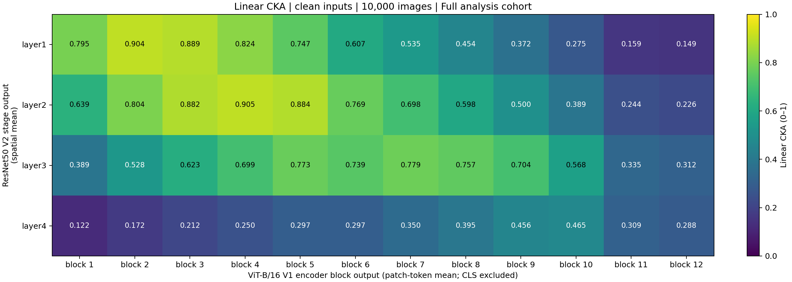

# Phân tích mức độ tương đồng biểu diễn giữa ResNet-50 và ViT-B/16 bằng CKA

ResNet-50 và ViT-B/16 đạt Top-1 lần lượt **80.844%** và **81.066%** trên 50.000 ảnh validation, chênh lệch **0.222 điểm phần trăm**. Khoảng cách nhỏ về độ chính xác đặt ra câu hỏi: **hai mô hình có tổ chức thông tin về cùng một tập ảnh theo cách tương tự nhau ở các tầng trung gian hay không?** Phần nghiên cứu này sử dụng Centered Kernel Alignment (CKA) để khảo sát câu hỏi đó theo độ sâu mạng. [Kết quả baseline](../results/metrics/baseline_notebook/full/summary.csv)

## Methodology

### 1. Câu hỏi nghiên cứu và đại lượng cần đo

Thí nghiệm tập trung vào hai câu hỏi:

1. Mỗi giai đoạn của ResNet-50 tương đồng nhất với khối mã hóa nào của ViT-B/16?
2. Mức tương đồng và vị trí các cặp tương đồng cao thay đổi như thế nào theo độ sâu?

Đối tượng so sánh là **biểu diễn đặc trưng ở cấp độ ảnh**, được tổng hợp từ đầu ra trung gian của từng mô hình. Hai tầng có thể có số kênh và cấu trúc không gian khác nhau; vì vậy, phép so sánh không ghép trực tiếp từng kênh CNN với từng chiều của token ViT. Thay vào đó, linear CKA đánh giá mức tương đồng trong cấu trúc quan hệ giữa các ảnh do hai biểu diễn tạo ra [1].

Đây là phép phân tích trên toàn bộ tập ảnh, không phải độ đo riêng cho từng ảnh. Nó bổ sung cho các bản đồ diễn giải: Grad-CAM và ERF khảo sát sự liên quan hoặc độ nhạy theo vị trí đầu vào, trong khi CKA khảo sát mối quan hệ giữa các biểu diễn trên nhiều mẫu.

### 2. Tập dữ liệu và cách chọn mẫu

Tập phân tích gồm **10.000 ảnh ImageNet-1K validation**, với 1.000 lớp và 10 ảnh mỗi lớp [6]. Manifest chung được tạo từ 50.000 ảnh validation bằng cách sắp xếp ID, duyệt các lớp theo thứ tự nhãn và lấy ngẫu nhiên 10 ảnh không hoàn lại trong mỗi lớp với seed 42. Các ID đã chọn được giữ cố định cho cả hai mô hình; không lấy mẫu lại ở từng tầng hoặc từng lượt trích xuất. [Quy trình chọn mẫu](../docs/analysis_set.md) · [Manifest phân tích](../data/manifests/analysis_10000_seed42.csv)

Việc sử dụng toàn bộ manifest có hai mục đích: duy trì cùng tập đánh giá với các thí nghiệm ImageNet của nhóm và giữ số ảnh cân bằng giữa 1.000 lớp. Nhờ đó, các lớp có cùng số mẫu trong tập phân tích. Tuy nhiên, CKA là thống kê gộp trên biểu diễn của toàn bộ ảnh, **không phải trung bình CKA của 1.000 lớp**. Thiết kế này cũng chưa bảo đảm độ chính xác riêng cho từng lớp hoặc một mức sai số thống kê định trước.

Số lượng 10.000 ảnh được kế thừa từ thiết kế dữ liệu chung của dự án, không được xác định từ phân tích công suất kiểm định hay pilot ước lượng sai số. Các lượt chạy ít ảnh trước đó chỉ phục vụ kiểm tra triển khai và không tham gia kết quả báo cáo.

Ảnh được đọc từ 14 tệp Parquet của validation split tại revision `49e2ee26f3810fb5a7536bbf732a7b07389a47b5`. Manifest và các tệp nguồn được kiểm chứng bằng SHA-256. Nhãn gốc 0–999 được giữ nguyên. Không loại mẫu dựa trên việc một hoặc cả hai mô hình phân loại đúng, nhằm tránh giới hạn phân tích vào những ảnh mà hai mô hình đã thống nhất về kết quả.

### 3. Mô hình và điều kiện đầu vào

Nghiên cứu sử dụng ResNet-50 [2] với trọng số `ResNet50_Weights.IMAGENET1K_V2` và ViT-B/16 [3] với trọng số `ViT_B_16_Weights.IMAGENET1K_V1`. Hai mô hình được nạp bằng mô-đun dùng chung của dự án, không huấn luyện hoặc tinh chỉnh bổ sung. [Triển khai nạp mô hình](../src/models.py)

Mỗi checkpoint sử dụng quy trình tiền xử lý chính thức tương ứng [4, 5]:

| Thành phần | ResNet-50 V2 | ViT-B/16 V1 |
| --- | --- | --- |
| Không gian màu | RGB | RGB |
| Resize cạnh ngắn | 232 pixel | 256 pixel |
| Nội suy | Song tuyến tính, có antialias | Song tuyến tính, có antialias |
| Vùng cắt | Center crop 224×224 | Center crop 224×224 |
| Giá trị trước chuẩn hóa | [0,1] | [0,1] |
| Trung bình chuẩn hóa | (0.485, 0.456, 0.406) | (0.485, 0.456, 0.406) |
| Độ lệch chuẩn | (0.229, 0.224, 0.225) | (0.229, 0.224, 0.225) |

Hai mô hình nhận cùng ID ảnh nhưng **không nhất thiết cùng vùng ảnh sau tiền xử lý**. Resize khác nhau trước khi cắt giữa dẫn đến khác biệt về trường nhìn. Do đó, kết quả phản ánh hai checkpoint cùng quy trình tiền xử lý chính thức, chưa phải phép đối chứng chỉ thay kiến trúc trong khi giữ nguyên mọi yếu tố khác.

### 4. Lựa chọn tầng: bốn giai đoạn CNN và mười hai khối Transformer

Với ResNet-50, đặc trưng được lấy ở cuối bốn giai đoạn `layer1`–`layer4`. Mỗi giai đoạn tổng hợp kết quả của một nhóm residual blocks tại một mức phân giải, cho phép khảo sát các biểu diễn từ nông đến sâu. Với đầu vào 224×224, đầu ra có cấu trúc như Bảng 1.

*Bảng 1. Đặc trưng ResNet-50 trước và sau tổng hợp không gian; B là kích thước batch.*

| Giai đoạn | Số residual blocks trong giai đoạn | Đầu ra trước tổng hợp | Vector mỗi ảnh |
| --- | ---: | --- | ---: |
| `layer1` | 3 | B×256×56×56 | 256 |
| `layer2` | 4 | B×512×28×28 | 512 |
| `layer3` | 6 | B×1024×14×14 | 1024 |
| `layer4` | 3 | B×2048×7×7 | 2048 |

Với ViT-B/16, đầu ra của **cả 12 encoder blocks** được khảo sát. Ảnh 224×224 được chia thành lưới 14×14 patches kích thước 16×16, tương ứng 196 patch tokens. Cùng CLS token ở đầu chuỗi, đầu ra mỗi block có kích thước B×197×768. Các đầu ra được lấy sau residual cuối của block và trước lớp chuẩn hóa `encoder.ln` ở cuối encoder.

Việc so sánh bốn stages với toàn bộ 12 blocks tạo ra **48 cặp tầng**. Thiết kế này không giả định trước một cặp ghép cố định như stage 1–block 3 hay stage 4–block 12; vị trí tương đồng lớn nhất được xác định từ ma trận đo được. Tuy nhiên, bốn stages chỉ là các mốc được chọn của ResNet, không đại diện cho toàn bộ từng residual block.

### 5. Từ đầu ra trung gian đến một vector cho mỗi ảnh

**ResNet-50: trung bình theo không gian.** Gọi $A_i^{(s)}\in\mathbb{R}^{C_s\times H_s\times W_s}$ là đầu ra stage $s$ của ảnh $i$. Mỗi kênh được tổng hợp bằng:

$$
x_{i,c}^{(s)}=\frac{1}{H_sW_s}\sum_{h=1}^{H_s}\sum_{w=1}^{W_s}A_{i,c,h,w}^{(s)}.
$$

Vector $x_i^{(s)}$ có $C_s$ chiều, thể hiện đáp ứng trung bình của từng kênh trên toàn lưới. Cách tổng hợp này cho phép dùng cùng một quy tắc cho các stages có độ phân giải khác nhau và hạn chế số chiều đặc trưng.

**ViT-B/16: trung bình patch tokens.** Gọi $T_i^{(b)}\in\mathbb{R}^{197\times768}$ là đầu ra block $b$, với token số 0 là CLS. Vector đại diện cho ảnh được tính bằng:

$$
y_{i,d}^{(b)}=\frac{1}{196}\sum_{p=1}^{196}T_{i,p,d}^{(b)}.
$$

CLS token không tham gia phép trung bình. Lựa chọn này sử dụng các biểu diễn gắn với lưới ảnh thay vì vector tổng hợp dùng trong nhánh phân loại, đồng thời tạo quy tắc tổng hợp toàn ảnh gần với spatial mean của CNN. Hai phép tổng hợp có mục đích tương ứng nhưng không bảo đảm hai loại vector có cùng ý nghĩa ngữ nghĩa. Chưa có thí nghiệm CLS hoặc pooling khác để xác định độ nhạy của kết quả đối với lựa chọn này.

Sau tổng hợp, các vector của 10.000 ảnh được xếp thành $X^{(s)}\in\mathbb{R}^{10000\times C_s}$ và $Y^{(b)}\in\mathbb{R}^{10000\times768}$. Mỗi hàng là một ảnh, mỗi cột là một chiều đặc trưng. ID và nhãn được kiểm tra về tính duy nhất, đầy đủ và nhất quán; hai ma trận được căn chỉnh theo manifest. Việc này cần thiết vì thứ tự đọc Parquet khác thứ tự manifest: ghép theo vị trí đọc mà không kiểm ID sẽ làm mất sự tương ứng giữa các mẫu.

### 6. Định tâm và tính linear CKA

Trước khi so sánh một cặp tầng, lấy trung bình từng chiều trên toàn bộ $N=10000$ ảnh:

$$
\mu_X=\frac{1}{N}\sum_{i=1}^{N}x_i,\qquad
\mu_Y=\frac{1}{N}\sum_{i=1}^{N}y_i,
$$

$$
X_c=X-\mathbf{1}\mu_X^T,\qquad
Y_c=Y-\mathbf{1}\mu_Y^T.
$$

Định tâm loại bỏ thành phần trung bình theo tập mẫu; không chia từng chiều cho độ lệch chuẩn và không chuẩn hóa độ dài riêng từng vector. Từ đó tính ba ma trận:

$$
S_{XY}=X_c^TY_c,\qquad S_{XX}=X_c^TX_c,\qquad S_{YY}=Y_c^TY_c,
$$

và điểm tương đồng:

$$
\operatorname{CKA}(X,Y)=
\frac{\lVert S_{XY}\rVert_F^2}
{\lVert S_{XX}\rVert_F\,\lVert S_{YY}\rVert_F}.
$$

Trong công thức này, $\lVert\cdot\rVert_F$ là chuẩn Frobenius. Tử số tổng hợp độ liên hệ chéo giữa hai bộ đặc trưng; mẫu số chuẩn hóa theo cấu trúc nội tại của từng biểu diễn. Nghiên cứu sử dụng biến thể **biased linear CKA** với đường chéo của các ma trận tương đồng được giữ lại, không áp dụng hiệu chỉnh HSIC không chệch [1].

CKA là phép so sánh cấu trúc trên toàn bộ tập ảnh: giá trị 0.90 không có nghĩa “90% ảnh giống nhau”, “90% kênh trùng nhau” hoặc “accuracy 90%”. Không có ngưỡng định trước để phân loại cặp tầng thành tương đương hay khác biệt trong nghiên cứu này.

### 7. Tính toán theo khối và kiểm chứng triển khai

Các tích chéo được tích lũy theo những khối $I_k$ gồm tối đa 512 ảnh:

$$
S_{XY}=\sum_k\big(X_{I_k}-\mathbf{1}\mu_X^T\big)^T
\big(Y_{I_k}-\mathbf{1}\mu_Y^T\big).
$$

Các khối dùng **cùng trung bình toàn tập**. Tổng trên tái tạo $X_c^TY_c$ tới sai số số học; sau khi tích lũy đủ ảnh mới tính một điểm CKA. Vì vậy, block size là tham số tính toán, không phải cỡ mẫu của từng điểm và không tạo phép lấy trung bình CKA theo batch. $S_{XX}$, $S_{YY}$ được tính tương tự; chuẩn của mỗi tầng được tái sử dụng giữa các cặp.

Hai mô hình chạy lần lượt ở chế độ đánh giá, không tính gradient. Forward hooks chỉ ghi nhận đầu ra, không sửa logits. Đặc trưng được tổng hợp ngay trong mỗi lượt forward, sau đó lưu ở float32 trên CPU; trung bình, tích chéo và chuẩn được tính bằng float64. Không tạo ma trận Gram N×N. Tổng bộ nhớ của các vector đặc trưng khoảng 522 MB; ma trận tích chéo lớn nhất 2048×2048 chiếm khoảng 34 MB ở float64.

Các kiểm tra triển khai gồm: CKA của một biểu diễn không suy biến với chính nó gần 1; tính đối xứng; tính bất biến khi hoán vị đồng thời các hàng; kết quả theo khối khớp công thức trực tiếp trên dữ liệu tổng hợp; từ chối dữ liệu NaN/Inf hoặc có phương sai bằng 0. Hook được kiểm tra về kích thước đầu ra, bảo toàn logits và được gỡ sau thực thi. Đặc trưng hằng làm CKA không xác định, không được quy thành điểm 0. [Mã phương pháp](../experiments/cka/cka.py) · [Notebook thực nghiệm](../notebooks/05_cka.ipynb)

Lần chạy chính thực hiện trên CPU, batch size 16, bằng PyTorch 2.15.0+cpu và torchvision 0.29.2+cpu. Metadata lưu checkpoint, tiền xử lý, tập ảnh, seed, phiên bản thư viện và dấu vết mã nguồn để hỗ trợ tái lập.

### 8. Chiến lược phân tích kết quả

Đặt $M_{s,b}=\operatorname{CKA}(X^{(s)},Y^{(b)})$ để xây dựng ma trận 4×12. Bản đồ nhiệt dùng thang cố định 0–1. Với mỗi stage, vị trí cực đại được xác định bởi $b_s^*=\arg\max_bM_{s,b}$; đồng thời xem các cặp lân cận về điểm để tránh diễn giải quá mức một cực đại đơn lẻ.

Phân tích hiện tại là **mô tả**: báo cáo khoảng giá trị, các cực đại và xu hướng theo độ sâu. Mỗi ô là một thống kê trên cả tập ảnh, nên không có 10.000 điểm CKA độc lập cho từng cặp tầng. Do đó, nghiên cứu không áp dụng trực tiếp kiểm định ghép cặp trên từng ảnh như đối với chỉ số ERF. Bootstrap CKA có thể được triển khai bằng cách lấy lại mẫu và tính lại toàn bộ phép đo, nhưng chưa được thực hiện; báo cáo không đưa ra p-value hoặc khoảng tin cậy.

## Results

### 1. Hoàn thành tập phân tích và ma trận tương đồng

Lần chạy `full_20261105T011722Z_85319525` hoàn thành đủ 10.000 ảnh cho cả hai mô hình. ID khớp manifest, không có mẫu bị loại; checksum dữ liệu nguồn và manifest được xác minh. Ma trận gồm 48 giá trị hữu hạn trong khoảng **0.122231–0.904623**. [Ma trận số liệu](../results/metrics/experiments/cka/full_20261105T011722Z_85319525/final/cka_matrix.csv) · [Metadata thực nghiệm](../results/metrics/experiments/cka/full_20261105T011722Z_85319525/final/metadata.json)

*Hình 1. Linear CKA giữa spatial-mean outputs của ResNet-50 V2 (hàng) và patch-token-mean outputs của ViT-B/16 V1, loại CLS token (cột), trên 10.000 ảnh ImageNet-1K validation. Block 1–12 tương ứng encoder_layer_0–11. Mỗi ô dùng cùng toàn bộ tập ảnh; màu sắc và số trong ô biểu thị CKA trên thang 0–1.*

### 2. Các cặp tương đồng lớn nhất

*Bảng 2. Cực đại theo từng giai đoạn ResNet và một cặp khác có điểm gần cực đại.*

| ResNet stage | ViT block đạt cực đại | CKA lớn nhất | Cặp khác để đối chiếu | CKA |
| --- | ---: | ---: | --- | ---: |
| `layer1` | 2 | 0.903906 | block 3 | 0.888823 |
| `layer2` | 4 | 0.904623 | block 5 | 0.883965 |
| `layer3` | 7 | 0.779259 | block 5 | 0.773136 |
| `layer4` | 10 | 0.465303 | block 9 | 0.455773 |

Cặp cao nhất toàn ma trận là `layer2`–block 4, tiếp theo là `layer1`–block 2, chênh **0.000717**. Các cặp tiếp theo trong năm điểm cao nhất là `layer1`–block 3 (0.888823), `layer2`–block 5 (0.883965) và `layer2`–block 3 (0.882359). Chênh lệch giữa cực đại và cặp đối chiếu của `layer3` là 0.006123; với `layer4` là 0.009530. Các số này là độ chênh quan sát, chưa được kiểm định về ý nghĩa thống kê.

### 3. Xu hướng trên toàn bộ độ sâu ViT

*Bảng 3. Một số mốc của đường CKA theo độ sâu ViT; bảng không thay thế toàn bộ ma trận 4×12.*

| ResNet stage | ViT block 1 | Giá trị cực đại | ViT block 12 |
| --- | ---: | ---: | ---: |
| `layer1` | 0.7952 | 0.9039 (block 2) | 0.1485 |
| `layer2` | 0.6388 | 0.9046 (block 4) | 0.2259 |
| `layer3` | 0.3886 | 0.7793 (block 7) | 0.3117 |
| `layer4` | 0.1222 | 0.4653 (block 10) | 0.2884 |

Các stages đầu có vùng tương đồng lớn ở các blocks đầu ViT, rồi giảm về cuối chuỗi. `layer3` có vùng điểm cao hơn ở các blocks giữa, với cực đại tại block 7. `layer4` đạt điểm lớn nhất ở block 10, nhưng cực đại thấp hơn cực đại của ba stages trước. Hai blocks cuối 11–12 không đạt cực đại ở bất kỳ hàng nào. Các đỉnh vì vậy dịch sang phải trên heatmap khi đi từ stage đầu tới stage cuối ResNet.

## Discussion

### 1. Các tầng có tương ứng theo độ sâu hay không?

Dãy vị trí cực đại **2 → 4 → 7 → 10** cho thấy sự tương ứng có thứ tự theo độ sâu trong các mốc được khảo sát. Điều này phù hợp với nhận xét rằng hai mô hình có những mức xử lý mà cấu trúc biểu diễn của ảnh tương đối gần nhau, dù cơ chế kiến trúc khác nhau. Tuy nhiên, ResNet chỉ được lấy mẫu ở cuối bốn stages; chỉ số block và tỷ lệ khối đã đi qua không biểu thị cùng chi phí tính toán hoặc cùng chức năng ở hai mạng.

Sự tương ứng ở đây mang tính tương đối: một block có điểm cao nhất trong một hàng không được xem là “tầng tương đương” theo nghĩa chức năng. Các vùng điểm cao trải qua nhiều blocks, đặc biệt ở `layer3`, cũng cho thấy chỉ báo cáo argmax sẽ bỏ qua một phần cấu trúc của ma trận.

### 2. Điểm thấp hơn ở stage cuối có ý nghĩa gì?

Cực đại của `layer4` là **0.4653**, trong khi hai stages đầu đạt gần **0.90**. Vì phép đo đã khảo sát toàn bộ 12 blocks ViT, kết quả cho thấy spatial-mean representation cuối của ResNet ít tương đồng hơn với các patch-mean representations được chọn của ViT trong tập thí nghiệm này.

Một giả thuyết có thể đặt ra là hai mô hình tổng hợp thông tin khác nhau ở các mức sâu. Tuy nhiên, thí nghiệm chưa kiểm tra giả thuyết đó một cách độc lập: ViT không được đo bằng CLS token, các đầu ra được lấy trước final encoder LayerNorm, và cả hai mạng đều chịu ảnh hưởng của phép pooling. Không thể từ các điểm hiện tại kết luận ViT dựa vào shape hơn, nhìn toàn cục hơn hoặc có khả năng chống nhiễu tốt hơn CNN.

### 3. Phép tổng hợp và tiền xử lý giới hạn kết luận như thế nào?

Spatial mean và patch mean làm mất vị trí đặc trưng. Hai bản đồ không gian khác nhau có thể tạo vector trung bình gần nhau; ngược lại, khác biệt giữa các vector trung bình không chỉ ra vùng ảnh cụ thể gây ra khác biệt. Vì vậy, CKA hiện tại chỉ mô tả các biểu diễn đã tổng hợp, không thay thế so sánh attention maps, Grad-CAM hoặc ERF.

Hai mô hình dùng cùng ảnh gốc nhưng khác resize trước crop. Chênh lệch CKA có thể bao gồm ảnh hưởng của vùng quan sát, bộ trọng số và quá trình huấn luyện, bên cạnh kiến trúc. Điều kiện crop chung hoặc so sánh CLS là những phép kiểm tra độ nhạy có thể bổ sung, chưa phải các kết quả đã được thực hiện trong phần nghiên cứu này.

### 4. Độ tin cậy và phạm vi khái quát hóa

Việc giữ cố định 10.000 ID và cân bằng số ảnh mỗi lớp tạo điều kiện so sánh nhất quán. Tuy nhiên, đây vẫn là một tập ảnh và một cặp checkpoint; chưa có khoảng tin cậy, thử nghiệm nhiều tập con hoặc phân tích theo lớp. Hai cặp cao nhất chỉ chênh 0.000717, nên không có cơ sở khẳng định một cặp vượt trội ổn định về ý nghĩa thống kê.

Phép đo sử dụng biến thể biased linear CKA; các điểm phụ thuộc vào phân bố mẫu, số chiều và cách tổng hợp. Báo cáo không diễn giải điểm tuyệt đối như một tỷ lệ thông tin chung hoặc mức tương đương của mô hình. Các lượt smoke nhỏ không được dùng làm mốc so sánh khoa học với full run.

Trong phạm vi đã khảo sát, kết luận được hỗ trợ là: **mức tương đồng của các biểu diễn đã pooling không đồng đều theo độ sâu; các cực đại dịch về blocks ViT sâu hơn qua các stages ResNet, trong khi cực đại của stage cuối thấp hơn các stages trước**. Việc liên hệ xu hướng này với khả năng diễn giải và robustness cần dựa trên các phép đo bổ sung của nhóm, với cùng ID ảnh và điều kiện đầu vào tương thích.

## References

[1] S. Kornblith, M. Norouzi, H. Lee, and G. Hinton. “Similarity of Neural Network Representations Revisited.” *Proceedings of the 36th International Conference on Machine Learning*, PMLR 97, pp. 3519–3529, 2019. [Paper](https://proceedings.mlr.press/v97/kornblith19a.html).

[2] K. He, X. Zhang, S. Ren, and J. Sun. “Deep Residual Learning for Image Recognition.” *Proceedings of the IEEE Conference on Computer Vision and Pattern Recognition*, 2016. [Paper](https://arxiv.org/abs/1512.03385).

[3] A. Dosovitskiy et al. “An Image Is Worth 16×16 Words: Transformers for Image Recognition at Scale.” *International Conference on Learning Representations*, 2021. [Paper](https://arxiv.org/abs/2010.11929).

[4] Torchvision. “ResNet50: Model Weights and Preprocessing.” [Documentation](https://docs.pytorch.org/vision/stable/models/generated/torchvision.models.resnet50.html).

[5] Torchvision. “ViT-B/16: Model Weights and Preprocessing.” [Documentation](https://docs.pytorch.org/vision/stable/models/generated/torchvision.models.vit_b_16.html).

[6] ILSVRC. “ImageNet-1K.” Validation split, revision `49e2ee26f3810fb5a7536bbf732a7b07389a47b5`. [Dataset](https://huggingface.co/datasets/ILSVRC/imagenet-1k).
