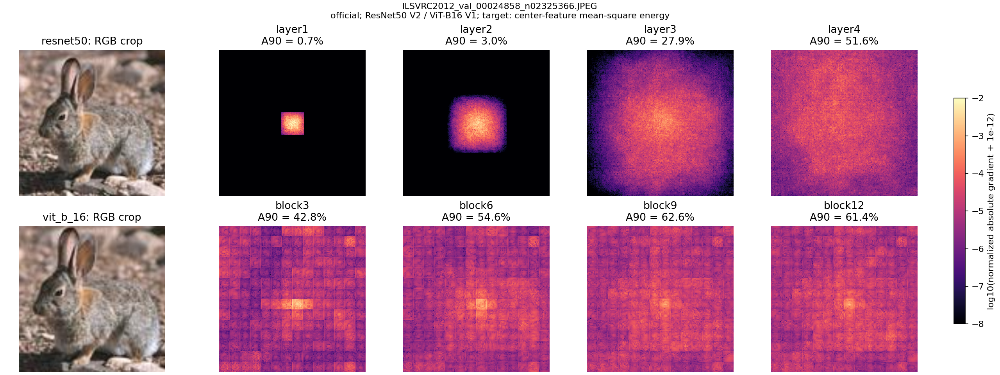
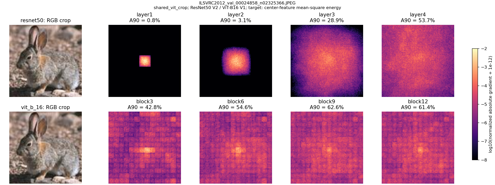
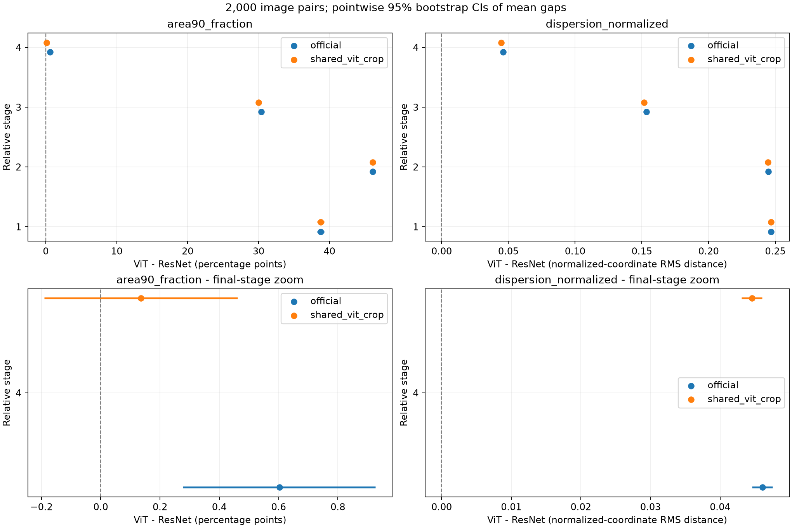
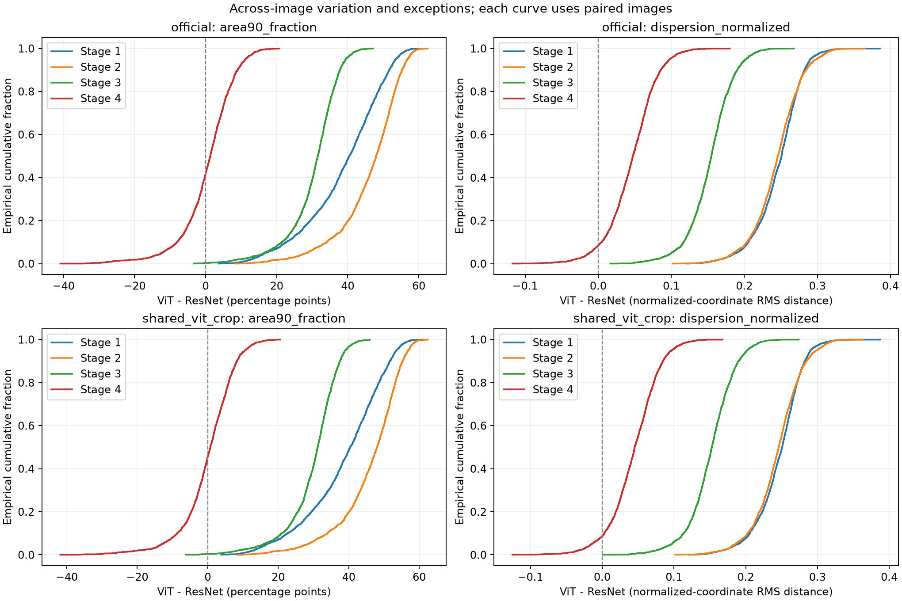
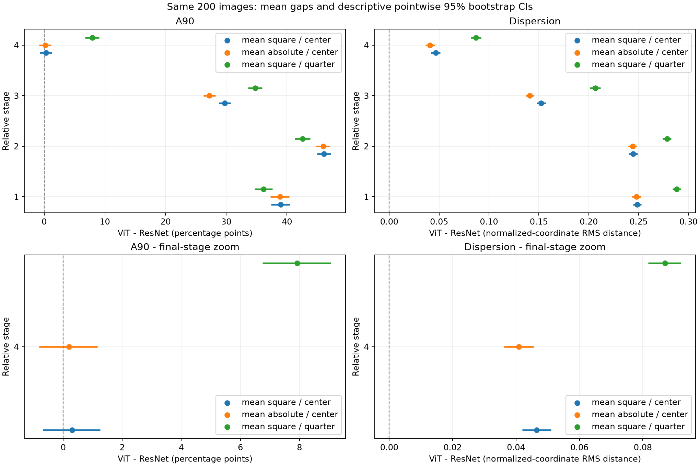
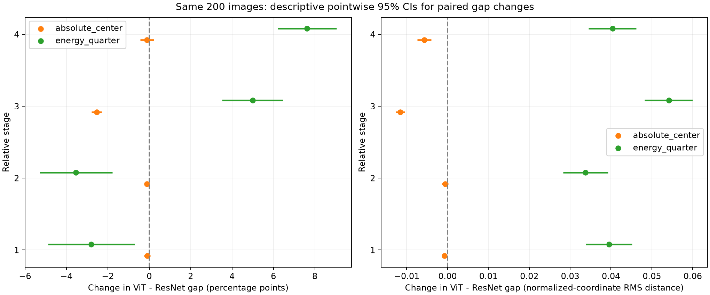

# Trường tiếp nhận hiệu dụng (ERF) của ResNet-50 và ViT-B/16

ResNet-50 và ViT-B/16 có độ chính xác Top-1 gần nhau trong đánh giá chuẩn của nhóm, lần lượt là **80,844%** và **81,066%**. Câu hỏi chính của phần này là **hai mô hình khác nhau thế nào về phạm vi và sự phân bố độ nhạy của các đặc trưng trung gian đối với ảnh đầu vào?** [Kết quả đánh giá chuẩn](../README.md#verified-baseline-results)

## Phương pháp (Methodology)

### Receptive field và effective receptive field khác nhau thế nào?

- **Receptive field (RF), hay trường tiếp nhận lý thuyết,** là tập các pixel đầu vào có đường truyền thông tin đến đặc trưng được chọn theo cấu trúc mạng. RF trả lời câu hỏi *những pixel nào có thể ảnh hưởng đến đặc trưng này?* Ví dụ, với hai lớp tích chập 3 × 3 liên tiếp, stride 1, một ô ở xa biên của lớp thứ hai có thể nhận thông tin từ một vùng 5 × 5 trên ảnh đầu vào.
- **Effective receptive field (ERF), hay trường tiếp nhận hiệu dụng,** cho biết ảnh hưởng mạnh hay yếu ở từng pixel. Trong thí nghiệm này, nhóm dùng gradient để đo đặc trưng đã chọn nhạy đến mức nào nếu thay đổi rất nhẹ mỗi pixel của một ảnh cụ thể. Chẳng hạn, trong vùng 5 × 5 ở ví dụ trên, vài pixel gần giữa có thể mang phần lớn độ nhạy, dù cả 25 pixel đều thuộc RF lý thuyết. ERF có thể thay đổi theo ảnh, trọng số mô hình và đặc trưng được đo. [Luo et al. (2016)](https://proceedings.neurips.cc/paper_files/paper/2016/file/c8067ad1937f728f51288b3eb986afaa-Paper.pdf)

Ở ResNet, các lớp tích chập kết hợp thông tin từ vùng lân cận, nên RF lý thuyết có thể mở rộng qua nhiều tầng. Ở ViT-B/16, nhờ self-attention toàn cục, một token ảnh có thể nhận thông tin từ mọi patch ngay sau khối Transformer đầu tiên. Đó là phạm vi **có thể** ảnh hưởng. Bản đồ ERF cho thấy vùng nào có độ nhạy cao hay thấp trong phạm vi ấy. [Luo et al. (2016)](https://proceedings.neurips.cc/paper_files/paper/2016/file/c8067ad1937f728f51288b3eb986afaa-Paper.pdf) · [Dosovitskiy et al. (2021)](https://arxiv.org/abs/2010.11929)

### Mô hình, ảnh và cách tiền xử lý

Nhóm dùng ResNet-50 với trọng số `IMAGENET1K_V2` và ViT-B/16 với trọng số `IMAGENET1K_V1`. Hai mô hình được đánh giá trên cùng **2.000 ảnh**, gồm 2 ảnh từ mỗi lớp trong 1.000 lớp ImageNet. Ảnh được chọn từ danh sách 10.000 ảnh của nhóm bằng seed 42, theo thứ tự lớp và ID, độc lập với dự đoán của mô hình. [Danh sách ảnh đã chọn](../results/metrics/experiments/erf/validated_2000_20261104_ready/final/selected_images.csv)

Thí nghiệm dùng hai cách chuẩn bị ảnh để xem khác biệt giữa hai mô hình có giữ khi chúng nhận cùng phần ảnh hay không.

| Điều kiện | ResNet-50 | ViT-B/16 |
|---|---|---|
| Tiền xử lý chính thức (`official`) | Đổi cạnh ngắn thành 232 pixel, cắt vùng tâm 224 × 224 | Đổi cạnh ngắn thành 256 pixel, cắt vùng tâm 224 × 224 |
| Vùng ảnh chung (`shared_vit_crop`) | Dùng cách đổi kích thước và cắt ảnh của ViT | Đổi cạnh ngắn thành 256 pixel, cắt vùng tâm 224 × 224 |

### Vì sao chọn 2.000 ảnh?

Trước thí nghiệm chính, pilot gồm **100 ảnh**. Ở mốc đầu, độ lệch chuẩn của chênh lệch A90 ghép cặp là **11,13 điểm phần trăm**, lớn hơn ở ba mốc còn lại trong pilot. Độ lệch chuẩn cho biết chênh lệch giữa hai mô hình dao động mạnh đến đâu từ ảnh này sang ảnh khác. Nhóm muốn ước lượng chênh lệch trung bình với sai số khoảng **0,5 điểm phần trăm** ở mức tin cậy 95%. Công thức lập kế hoạch gần đúng là `n ≈ (1,96 × 11,13 / 0,5)²`, cho kết quả khoảng **1.903 ảnh**. Hệ số 1,96 tương ứng với khoảng 95% trong phép tính xấp xỉ. [Kết quả pilot 100 ảnh](../experiments/erf/archive/04_erf_100.ipynb) · [NIST giải thích khoảng tin cậy cho trung bình](https://www.itl.nist.gov/div898/handbook/eda/section3/eda352.htm)

Nhóm làm tròn lên **2.000 ảnh**, vừa đáp ứng cỡ mẫu ước tính, vừa lấy đúng **2 ảnh của mỗi lớp ImageNet**. Cách chia này giữ đủ cả 1.000 lớp trong phép so sánh gộp, để kết quả không chỉ phản ánh một nhóm nhỏ lớp. Hai ảnh mỗi lớp được chọn từ danh sách 10.000 ảnh bằng seed 42, không dựa trên việc mô hình đoán đúng hay sai. Mức sai số 0,5 điểm phần trăm dùng cho việc lập kế hoạch chênh lệch A90 mốc đầu. Đây là ước tính gần đúng từ pilot, không phải bảo đảm độ chính xác riêng cho mọi mốc, mọi chỉ số hoặc từng lớp.

### Vì sao chọn bốn mốc để so sánh?

**Với ResNet-50, nhóm lấy đầu ra của từng cụm xử lý.** Mạng có bốn cụm `layer1` đến `layer4`, lần lượt gồm 3, 4, 6 và 3 khối dư. Sau mỗi cụm, đặc trưng nằm trên một lưới có kích thước riêng. Với đầu vào 224 × 224, lưới lần lượt là 56 × 56, 28 × 28, 14 × 14 và 7 × 7. Đo ở cuối mỗi cụm cho biết độ nhạy của đặc trưng sau khi mô hình đã hoàn tất xử lý ở mức phân giải đó.

**Với ViT-B/16, nhóm lấy một mốc sau mỗi ba khối.** ViT có 12 khối Transformer liên tiếp và giữ lưới 14 × 14 token ảnh qua các khối. Để lấy bốn mẫu dọc theo độ sâu, nhóm đo sau khối 3, 6, 9 và 12, tức là sau một phần tư, một nửa, ba phần tư và toàn bộ chuỗi khối Transformer.

| Giai đoạn so sánh | ResNet-50 | ViT-B/16 |
|---|---|---|
| 1 | Sau `layer1` (3/16 khối dư) | Sau `block3` (3/12 khối Transformer) |
| 2 | Sau `layer2` (7/16 khối dư) | Sau `block6` (6/12 khối Transformer) |
| 3 | Sau `layer3` (13/16 khối dư) | Sau `block9` (9/12 khối Transformer) |
| 4 | Sau `layer4` (16/16 khối dư) | Sau `block12` (12/12 khối Transformer), trước LayerNorm cuối |

Hai mốc được ghép **theo thứ tự từ nông đến sâu** trong mỗi mạng. Chẳng hạn, cặp `layer1` và `block3` là mốc sớm nhất được đo của hai mô hình. Tỷ lệ khối đã qua, chi phí tính toán và vùng ảnh tương ứng có thể khác nhau. Vì vậy, các cặp này dùng để so sánh xu hướng ERF dọc theo hai mạng. [Định nghĩa mốc trong code](../experiments/erf/erf_experiment.py)

### Từ một ảnh đến bản đồ ERF

Một **đặc trưng trung gian** là tập các giá trị mà mô hình tạo ra khi đang xử lý ảnh. Ở mỗi mốc trong bảng, nhóm lấy đặc trưng tại một ô gần tâm trên lưới ResNet và token đại diện cho ô ảnh gần tâm trên lưới ViT.

1. **Chọn đặc trưng.** Dùng hàng `H // 2` và cột `W // 2` trên lưới. Với ViT, vị trí này ứng với token ảnh số 106 trong chuỗi có token phân loại CLS ở đầu.
2. **Tóm tắt đặc trưng thành một số.** Bình phương từng thành phần của vector đặc trưng, rồi lấy trung bình. Đại lượng cần đo là `z = mean(f²)`.
3. **Tính độ nhạy theo pixel.** Gradient cho biết `z` sẽ thay đổi nhanh thế nào khi giá trị đầu vào thay đổi rất nhỏ. Tại mỗi pixel, cộng độ lớn gradient của ba kênh đỏ, lục và lam. Pixel có giá trị cao hơn là pixel mà `z` nhạy hơn với thay đổi nhỏ.

Độ nhạy được tính theo giá trị RGB trong khoảng `[0, 1]` của vùng ảnh 224 × 224 sau khi cắt. Về kỹ thuật, PyTorch tính gradient theo đầu vào đã chuẩn hóa, sau đó nhóm chia gradient mỗi kênh cho độ lệch chuẩn dùng khi chuẩn hóa để đưa phép đo về thang RGB ban đầu. Mô hình ở chế độ đánh giá (`eval`) và phép tính vẫn bật gradient. [Chi tiết triển khai](../docs/erf.md)

### Hai cách đọc cùng một bản đồ

- **A90 đo cần bao nhiêu pixel.** Xếp pixel từ nhạy nhất xuống thấp nhất rồi cộng độ nhạy cho đến khi đạt 90% tổng. A90 là tỷ lệ pixel đã dùng. Ví dụ, nếu cần 12 pixel mạnh nhất trong một ảnh 100 pixel, A90 là 12%. Các pixel được chọn có thể nằm rải rác. **A50** dùng cùng cách tính với mốc 50%.
- **Dispersion đo các pixel có độ nhạy nằm xa nhau đến đâu.** Hãy coi độ nhạy là trọng lượng đặt trên từng pixel. Sau khi tìm điểm cân bằng của bản đồ, tính căn bậc hai của trung bình có trọng số của bình phương khoảng cách đến điểm đó. Tọa độ ảnh được đưa về thang `[0, 1]`. Dispersion lớn hơn nghĩa là độ nhạy trải xa hơn quanh trọng tâm.

Hai bản đồ có thể cần cùng số pixel để đạt 90% tổng độ nhạy. Nếu các pixel của một bản đồ nằm xa trọng tâm hơn, bản đồ đó vẫn có dispersion lớn hơn.

### Cách so sánh giữa hai mô hình

Trên mỗi ảnh, nhóm tính hiệu số `ViT − ResNet` cho cùng mô hình đo và cùng mốc. Đây là **so sánh ghép cặp**: hai kết quả được ghép theo đúng ID ảnh trước khi trừ, giống như so điểm hai học sinh làm cùng một câu hỏi. Mỗi điều kiện có **2.000 cặp ảnh**. Giá trị dương nghĩa là chỉ số ViT cao hơn. Với A90, hiệu số tính theo **điểm phần trăm**.

#### Khoảng tin cậy bằng bootstrap

Khoảng tin cậy 95% (**CI95%**) cho biết ước lượng chênh lệch trung bình có độ bất định thế nào. Để ước lượng, nhóm lấy lại mẫu **2.000 hiệu số ghép cặp có hoàn lại**, tính trung bình, rồi lặp lại **20.000 lần**. “Có hoàn lại” nghĩa là một ảnh có thể được chọn nhiều lần trong một lượt lấy mẫu và một số ảnh khác có thể vắng mặt ở lượt đó. Hai đầu mút CI95% là phân vị 2,5% và 97,5% của 20.000 trung bình. Đây là bootstrap phân vị cho **chênh lệch trung bình**. Seed bootstrap được xác định từ seed 42 và số thứ tự của phép so sánh, để tái lập được kết quả. [Efron (1979), giới thiệu phương pháp bootstrap](https://projecteuclid.org/journals/annals-of-statistics/volume-7/issue-1/Bootstrap-Methods-Another-Look-at-the-Jackknife/10.1214/aos/1176344552.full)

CI95% đi qua 0 nghĩa là ước lượng trung bình vẫn còn phù hợp với chênh lệch bằng 0. Điều đó chưa chứng minh hai mô hình tương đương. Muốn kết luận tương đương, trước hết cần định ra mức chênh lệch nhỏ nhất có ý nghĩa thực tế. Các CI của 16 so sánh chính là **khoảng 95% riêng cho từng so sánh**, chưa hiệu chỉnh chung cho việc đọc 16 khoảng cùng lúc.

#### Kiểm định Wilcoxon signed-rank

**Kiểm định Wilcoxon signed-rank ghép cặp** dùng cả hướng lẫn độ lớn tương đối của chênh lệch từng ảnh. Trước tiên, nó xếp các chênh lệch theo độ lớn tuyệt đối, từ nhỏ đến lớn. Sau đó kiểm tra xem các thứ hạng lớn nghiêng về phía ViT hay ResNet. Nếu một phía lấn át có hệ thống, p-value nhỏ là bằng chứng chống lại giả thuyết rằng phân bố chênh lệch cân quanh 0. Kiểm định này thường được diễn giải dưới giả định chênh lệch có phân bố đối xứng quanh tâm. Trong thí nghiệm, phép kiểm định hai phía xét khác biệt theo cả hai hướng vì câu hỏi nghiên cứu chưa mặc định mô hình nào có chỉ số lớn hơn. [Wilcoxon (1945)](https://doi.org/10.2307/3001968) · [Tài liệu SciPy 1.16.3 về Wilcoxon](https://docs.scipy.org/doc/scipy-1.16.3/reference/generated/scipy.stats.wilcoxon.html)

Vì có **2.000 cặp**, SciPy dùng xấp xỉ chuẩn để tính p-value. Các chênh lệch được làm tròn 12 chữ số trước khi xếp hạng nhằm tránh khác biệt rất nhỏ do sai số tính toán. Các cặp có chênh lệch bằng 0 không tham gia xếp hạng. [Mã thống kê và cách ghép cặp](../experiments/erf/erf_statistics.py)

Wilcoxon trả lời liệu thứ hạng chênh lệch có nghiêng có hệ thống về một phía hay không. CI bootstrap ở phần trên ước lượng độ lớn của **chênh lệch trung bình**. Hai phép tính này không kiểm tra cùng một đại lượng. Vì vậy, p-value nhỏ có thể đi cùng CI của trung bình đi qua 0. Chẳng hạn, ở A90 mốc cuối với vùng ảnh chung, CI95% của trung bình là **−0,19 đến +0,46 điểm phần trăm**, còn p Holm là **4,08 × 10⁻⁵**. Điều này cho thấy kiểm định thứ hạng phát hiện xu hướng trong các chênh lệch từng ảnh, trong khi độ lớn trung bình vẫn có khoảng ước lượng chứa 0. Kết quả này không xác lập tương đương.

#### Hiệu chỉnh Holm cho 16 phép kiểm định

Mỗi phép kiểm định riêng dùng ngưỡng 0,05. Nhưng ở phân tích chính nhóm thực hiện **16 phép kiểm định Wilcoxon**: hai kiểu crop, hai chỉ số và bốn mốc. Càng làm nhiều phép thử, cơ hội có ít nhất một kết quả dương tính giả càng tăng. Hiệu chỉnh Holm sắp p-value từ nhỏ đến lớn rồi áp dụng các ngưỡng tăng dần nghiêm ngặt, nhằm giữ xác suất báo nhầm ít nhất một khác biệt trong cả nhóm 16 phép thử ở mức tối đa **5%**. Giá trị **p Holm** trong bảng là p-value đã hiệu chỉnh này. Trong report, p Holm dưới **0,05** được xem là bằng chứng thống kê về khác biệt theo thứ hạng giữa các mô hình. Độ lớn của khác biệt được đọc từ giá trị trung bình và CI95%. Các ô ghi *dưới ngưỡng số* là những p-value quá nhỏ để phần mềm biểu diễn, chứ không có nghĩa p-value đúng bằng 0. [Holm (1979), thủ tục kiểm định nhiều giả thuyết](https://doi.org/10.2307/4615733)

Các CI bootstrap vẫn là khoảng pointwise 95%, còn Holm hiệu chỉnh p-value của Wilcoxon. Những CI của kiểm tra độ nhạy trên 200 ảnh chỉ mô tả hai phép thử bổ sung, nằm ngoài nhóm 16 giả thuyết chính và không được hiệu chỉnh Holm.

## Kết quả (Results)

### Mẫu hình trên một ảnh minh họa

Hai hình dưới đây cho thấy cùng một ảnh con thỏ được chọn ngẫu nhiên. Mỗi hàng là một mô hình, còn các bản đồ lần lượt là các mốc từ nông đến sâu. Vàng và cam biểu thị pixel chiếm tỷ trọng lớn hơn trong độ nhạy của bản đồ, còn tím và đen biểu thị tỷ trọng nhỏ hơn. Mỗi bản đồ được chuẩn hóa riêng, nên hình so sánh cách độ nhạy trải trên ảnh.

Trên ảnh này, ResNet có một đốm nhạy nhỏ ở `layer1`, rồi vùng sáng mở rộng qua các mốc sau. A90 của ResNet tăng từ **0,8%** lên **53,7%**. Bản đồ ViT đã có độ nhạy ở các vùng xa điểm sáng giữa ngay tại `block3`, và hình vẫn rộng ở `block12`. A90 của ViT lần lượt là **42,8%, 54,6%, 62,6% và 61,4%**. Ở riêng ảnh này, ResNet chuyển từ bản đồ rất tập trung sang bản đồ rộng hơn, còn ViT rộng ngay từ mốc đầu được đo. Hai hình dùng cách cắt chính thức và cách cắt chung tương ứng.

### A90 qua bốn giai đoạn

Ảnh minh họa cho thấy diễn biến trên một trường hợp. Bảng dưới tổng hợp **2.000 ảnh**, mỗi mô hình và mỗi mốc. A90 là tỷ lệ pixel nhỏ nhất cần cộng dồn để đạt 90% tổng độ nhạy. Do đó, A90 thấp cho thấy độ nhạy tập trung vào ít pixel hơn; A90 cao cho thấy cần nhiều pixel hơn để đạt cùng ngưỡng. Chênh lệch dương nghĩa là A90 của ViT cao hơn ResNet.

| Điều kiện | Giai đoạn | ResNet | ViT | ViT − ResNet | CI95% của chênh lệch | p Holm |
|---|---:|---:|---:|---:|---|---:|
| Chính thức | 1 | 0,6474 | 39,4165 | +38,7691 | [+38,2864; +39,2481] | Dưới ngưỡng số |
| Chính thức | 2 | 2,9438 | 49,0433 | +46,0995 | [+45,7110; +46,4886] | Dưới ngưỡng số |
| Chính thức | 3 | 23,7820 | 54,1637 | +30,3817 | [+30,0668; +30,6968] | Dưới ngưỡng số |
| Chính thức | 4 | 52,9301 | 53,5330 | +0,6029 | [+0,2768; +0,9268] | 1,78e-12 |
| Vùng ảnh chung | 1 | 0,6474 | 39,4165 | +38,7691 | [+38,2917; +39,2454] | Dưới ngưỡng số |
| Vùng ảnh chung | 2 | 2,9540 | 49,0433 | +46,0894 | [+45,7026; +46,4690] | Dưới ngưỡng số |
| Vùng ảnh chung | 3 | 24,1849 | 54,1637 | +29,9788 | [+29,6640; +30,2923] | Dưới ngưỡng số |
| Vùng ảnh chung | 4 | 53,3977 | 53,5330 | +0,1353 | [-0,1900; +0,4614] | 4,08e-05 |

Ở mốc đầu với **cùng vùng ảnh**, A90 trung bình của ResNet là **0,65%**, tương đương khoảng **325 pixel** trong ảnh 224 × 224. ViT cần **39,42%**, gần **19.800 pixel**, để đạt cùng 90% độ nhạy. Như vậy, ở `layer1`, độ nhạy của ResNet tập trung hơn nhiều, còn ở `block3` của ViT độ nhạy đã phân bố trên một phần lớn vùng ảnh.

Qua các mốc tiếp theo, A90 của ResNet tăng mạnh từ **0,65%** lên **53,40%**. A90 của ViT thay đổi ít hơn, từ **39,42%** lên khoảng **53,53%** ở mốc cuối. Chênh lệch hai mô hình vì vậy giảm từ hơn **38 điểm phần trăm** ở mốc đầu xuống **0,14 điểm phần trăm** ở mốc cuối với cùng vùng ảnh. Khi mỗi mô hình dùng cách cắt chính thức của mình, chênh lệch cuối là **0,60 điểm phần trăm**. Dùng chung vùng ảnh làm A90 của ResNet ở mốc cuối tăng khoảng **0,47 điểm**, trong khi A90 của ViT không đổi trong hai điều kiện đã chạy. Kết quả cho thấy crop ảnh làm thay đổi độ gần nhau của A90 ở mốc cuối. [Bảng ảnh hưởng của crop](../results/metrics/experiments/erf/validated_2000_20261104_ready/final/crop_sensitivity.csv)

### Độ phân tán theo không gian

Hai bản đồ có thể cần gần cùng tỷ lệ pixel để gom 90% độ nhạy, nhưng những pixel nhạy vẫn có thể nằm cách xa nhau khác nhau. Dispersion đo độ trải của toàn bộ độ nhạy quanh trọng tâm của bản đồ, trên thang tọa độ ảnh chuẩn hóa. Giá trị cao hơn nghĩa là độ nhạy trải xa tâm hơn.

| Điều kiện | Giai đoạn | ResNet | ViT | ViT − ResNet | CI95% của chênh lệch | p Holm |
|---|---:|---:|---:|---:|---|---:|
| Chính thức | 1 | 0,0310 | 0,2776 | +0,2467 | [+0,2453; +0,2480] | Dưới ngưỡng số |
| Chính thức | 2 | 0,0661 | 0,3107 | +0,2447 | [+0,2432; +0,2461] | Dưới ngưỡng số |
| Chính thức | 3 | 0,1864 | 0,3398 | +0,1534 | [+0,1521; +0,1548] | Dưới ngưỡng số |
| Chính thức | 4 | 0,3053 | 0,3514 | +0,0461 | [+0,0446; +0,0476] | 3,15e-285 |
| Vùng ảnh chung | 1 | 0,0310 | 0,2776 | +0,2467 | [+0,2453; +0,2480] | Dưới ngưỡng số |
| Vùng ảnh chung | 2 | 0,0661 | 0,3107 | +0,2446 | [+0,2431; +0,2461] | Dưới ngưỡng số |
| Vùng ảnh chung | 3 | 0,1880 | 0,3398 | +0,1518 | [+0,1504; +0,1532] | Dưới ngưỡng số |
| Vùng ảnh chung | 4 | 0,3068 | 0,3514 | +0,0446 | [+0,0431; +0,0461] | 4,78e-280 |

Dispersion của ViT cao hơn ResNet ở cả bốn mốc trong cả hai điều kiện crop. Với cùng vùng ảnh ở mốc cuối, dispersion là **0,3514** ở ViT và **0,3068** ở ResNet. Kết hợp với A90 gần bằng nhau, kết quả cho thấy hai mô hình cần gần cùng số pixel để gom 90% độ nhạy, nhưng bản đồ ViT trải rộng hơn quanh trọng tâm.

Hình phân bố từng ảnh cho thấy mức A90 trung bình gần nhau không có nghĩa là hai mô hình cho A90 gần như nhau trên từng ảnh. Ở mốc cuối với cùng vùng ảnh, A90 của ViT thấp hơn ResNet trên **45,65% số ảnh**, và cao hơn trên **54,35%**. Ngược lại, dispersion của ViT cao hơn trên **91,4% số ảnh**. Sự khác nhau về cách trải độ nhạy của ViT xuất hiện trên phần lớn ảnh, dù số pixel cần gom đủ 90% gần bằng nhau khi lấy trung bình. [Bảng phân bố hiệu số](../results/metrics/experiments/erf/validated_2000_20261104_ready/final/paired_distribution_summary.csv)

### Kết quả thay đổi thế nào khi đổi cách đo?

Để xem kết quả phụ thuộc ra sao vào cách chọn đặc trưng, nhóm chọn cố định **200 ảnh thuộc 194 lớp** từ tập 2.000 ảnh bằng seed 42. Ba cấu hình dùng cùng 200 ảnh và cùng vùng ảnh. Cấu hình gốc dùng trung bình bình phương tại tâm. Mỗi kiểm tra thay đổi một thành phần của cấu hình gốc.

- **Đổi công thức tại tâm (`absolute_center`).** Lấy trung bình trị tuyệt đối `mean(abs(f))` thay cho trung bình bình phương. Giữ nguyên ô đặc trưng.
- **Đổi vị trí (`energy_quarter`).** Giữ trung bình bình phương và chuyển sang ô gần một phần tư theo mỗi chiều của lưới đặc trưng. Chỉ số mỗi chiều là `round(0.25 × (kích thước lưới − 1))`. Vùng ảnh đầu vào vẫn như nhau.

Các phép thử dưới đây dùng cùng **200 ảnh**, cùng vùng ảnh và cùng các checkpoint đã nêu trong phương pháp. Hai hàng đầu giữ ô gần tâm và chỉ đổi công thức tính feature. Hàng cuối giữ công thức gốc nhưng đo tại ô lệch lên phía trái. Bảng cho thấy A90 riêng của từng mô hình ở mốc cuối. [Bảng giá trị theo cấu hình](../results/metrics/experiments/erf/validated_sensitivity_200_20261105/final/sensitivity_profiles.csv)

| Cấu hình tại giai đoạn 4 | A90 ResNet (%) | A90 ViT (%) | ViT − ResNet (điểm phần trăm) | CI95% của chênh lệch |
|---|---:|---:|---:|---|
| Trung bình bình phương, ô gần tâm | 53,3368 | 53,6349 | +0,2981 | [-0,6903; +1,2482] |
| Trung bình trị tuyệt đối, ô gần tâm | 53,5631 | 53,7560 | +0,1930 | [-0,8122; +1,1581] |
| Trung bình bình phương, ô một phần tư | 42,9843 | 50,9093 | +7,9250 | [+6,7533; +9,0625] |

- **Đổi công thức tại tâm.** Với cả `mean(f²)` và `mean(abs(f))`, A90 của hai mô hình vẫn gần nhau, quanh **54%**. Nhận xét A90 gần nhau ở vị trí tâm vẫn đúng khi đổi công thức trong phép thử này.
- **Đổi vị trí.** Khi đo feature ở ô gần góc trên trái, A90 giảm ở cả hai mô hình. ResNet giảm từ **53,34% xuống 42,98%**, còn ViT giảm từ **53,63% xuống 50,91%**. ResNet thay đổi nhiều hơn, khiến chênh lệch A90 tăng từ **0,30 lên 7,92 điểm phần trăm**. Ở vị trí này, ResNet gom 90% độ nhạy bằng ít pixel hơn rõ rệt.

Hình so sánh ba cấu hình thể hiện cùng xu hướng. Hai phép đo tại tâm cho khoảng cách A90 nhỏ, còn phép đo lệch tâm làm khoảng cách giữa hai mô hình tăng rõ ở mốc cuối.

Bảng chi tiết cho thấy tác động của mỗi thay đổi ở từng mốc. Khi dời vị trí đo, chênh lệch A90 giảm ở hai mốc đầu rồi tăng ở hai mốc sau. Ở mốc cuối, chênh lệch A90 tăng thêm **7,63 điểm phần trăm** so với phép đo gốc. Dispersion cũng thay đổi ở cả bốn mốc, cho thấy vị trí đo ảnh hưởng đến hình dạng độ nhạy mà hai mô hình biểu diễn. [Bảng đủ 16 so sánh](../results/metrics/experiments/erf/validated_sensitivity_200_20261105/final/sensitivity_summary.csv) · [Dữ liệu từng cặp ảnh](../results/metrics/experiments/erf/validated_sensitivity_200_20261105/final/sensitivity_paired_differences.csv)

| Cách đo | Chỉ số | Giai đoạn | Chênh lệch gốc | Chênh lệch mới | Mức thay đổi và CI95% |
|---|---|---:|---:|---:|---|
| Đổi công thức tại tâm | A90 | 1 | +38,9481 | +38,8505 | -0,0976 [-0,2484; +0,0521] |
| Đổi công thức tại tâm | A90 | 2 | +46,1122 | +45,9973 | -0,1149 [-0,2355; +0,0089] |
| Đổi công thức tại tâm | A90 | 3 | +29,7768 | +27,2370 | -2,5398 [-2,7802; -2,2980] |
| Đổi công thức tại tâm | A90 | 4 | +0,2981 | +0,1930 | -0,1052 [-0,4334; +0,2257] |
| Đổi công thức tại tâm | Dispersion | 1 | +0,2487 | +0,2479 | -0,0008 [-0,0013; -0,0002] |
| Đổi công thức tại tâm | Dispersion | 2 | +0,2446 | +0,2440 | -0,0006 [-0,0014; +0,0002] |
| Đổi công thức tại tâm | Dispersion | 3 | +0,1524 | +0,1409 | -0,0115 [-0,0126; -0,0105] |
| Đổi công thức tại tâm | Dispersion | 4 | +0,0465 | +0,0409 | -0,0057 [-0,0074; -0,0040] |
| Đổi vị trí | A90 | 1 | +38,9481 | +36,1459 | -2,8022 [-4,8874; -0,6948] |
| Đổi vị trí | A90 | 2 | +46,1122 | +42,5715 | -3,5407 [-5,2852; -1,7730] |
| Đổi vị trí | A90 | 3 | +29,7768 | +34,7824 | +5,0055 [+3,5169; +6,4672] |
| Đổi vị trí | A90 | 4 | +0,2981 | +7,9250 | +7,6268 [+6,2025; +9,0523] |
| Đổi vị trí | Dispersion | 1 | +0,2487 | +0,2882 | +0,0395 [+0,0338; +0,0452] |
| Đổi vị trí | Dispersion | 2 | +0,2446 | +0,2784 | +0,0338 [+0,0282; +0,0392] |
| Đổi vị trí | Dispersion | 3 | +0,1524 | +0,2066 | +0,0541 [+0,0482; +0,0600] |
| Đổi vị trí | Dispersion | 4 | +0,0465 | +0,0870 | +0,0404 [+0,0345; +0,0462] |

Hình mức thay đổi củng cố sự khác nhau giữa hai phép thử tại tâm và phép thử lệch tâm. Đổi công thức hầu như không làm đổi chênh lệch A90 ở mốc cuối, còn đổi vị trí làm chênh lệch tăng mạnh. Kết quả gần nhau ở A90 mốc cuối vì vậy phụ thuộc vào feature và vị trí được chọn để đo.

## Thảo luận (Discussion)

### Trả lời các câu hỏi nghiên cứu

#### 1. Độ nhạy của ResNet thay đổi thế nào khi đi sâu hơn?

**Từ tập trung gần tâm đến trải rộng hơn trên ảnh.** Trong hình con thỏ, đốm sáng ở `layer1` nhỏ và mở rộng dần qua các mốc. Trên 2.000 ảnh có cùng vùng cắt, A90 trung bình của ResNet tăng qua cả bốn mốc, từ **0,65% → 2,95% → 24,18% → 53,40%**. Tức là ở mốc đầu, một nhóm pixel nhỏ đã chứa phần lớn độ nhạy. Đến mốc cuối, cần gom hơn nửa số pixel để đạt cùng ngưỡng 90%. Dispersion cũng tăng qua từng mốc, cho thấy độ nhạy còn trải xa hơn về mặt không gian. [Bảng kết quả theo giai đoạn](../results/metrics/experiments/erf/validated_2000_20261104_ready/final/paired_tests.csv)

#### 2. ViT có độ nhạy trải rộng ngay từ mốc đầu được khảo sát không?

**Có, từ `block3`, mốc sớm nhất được đo.** Ở cùng vùng ảnh, ViT cần **39,42%** số pixel để gom đủ 90% độ nhạy, so với **0,65%** ở mốc đầu của ResNet. Dispersion của ViT cũng cao hơn (**0,2776** so với **0,0310**), nghĩa là độ nhạy còn trải xa hơn quanh trọng tâm. Ảnh con thỏ cho thấy ViT có thể vừa nhạy với nhiều vùng xa tâm, vừa có một điểm đặc biệt nhạy gần tâm. Khả năng nhận thông tin từ toàn ảnh ở `block1` là đặc điểm của kiến trúc. Kết quả đo ERF trong báo cáo bắt đầu ở `block3`. [Bản đồ ERF trên cùng vùng ảnh](../results/figures/experiments/erf/main_2000_shared_vit_crop_20261103T161602_476613Z/final/image_00.png)

#### 3. Khi A90 ở mốc cuối gần nhau, hai mô hình có phân bố độ nhạy giống nhau không?

**Hai mô hình gần nhau về số pixel cần gom, nhưng độ nhạy của ViT vẫn trải xa hơn.** Trên cùng vùng ảnh và tại ô gần tâm, A90 ở mốc cuối là **53,40%** ở ResNet và **53,53%** ở ViT. Tuy vậy, dispersion của ViT cao hơn trên **91,4% số ảnh**. Nếu chỉ gom đến 50% tổng độ nhạy, ViT cần **10,70%** số pixel, còn ResNet cần **13,46%**. Như vậy, một phần lớn độ nhạy của ViT có thể nằm ở ít pixel mạnh, đồng thời toàn bộ bản đồ vẫn có độ trải không gian lớn hơn. [Phân bố hiệu số theo ảnh](../results/metrics/experiments/erf/validated_2000_20261104_ready/final/paired_distribution_summary.csv) · [Metric từng ảnh](../results/metrics/experiments/erf/main_2000_shared_vit_crop_20261103T161602_476613Z/final/metrics.csv)

CI95% của chênh lệch A90 trung bình ở mốc cuối đi từ **−0,19 đến +0,46 điểm phần trăm**, qua 0. Giá trị p Holm **4,08 × 10⁻⁵** đến từ một phép kiểm định khác, dựa trên dấu và thứ hạng của hiệu số từng ảnh. Hai kết quả có thể xuất hiện đồng thời. Để kết luận hai A90 tương đương, cần xác định trước mức chênh lệch tối đa có thể coi là nhỏ về mặt thực tiễn. [Bảng kiểm định ghép cặp](../results/metrics/experiments/erf/validated_2000_20261104_ready/final/paired_tests.csv)

#### 4. Kết luận có giữ khi đổi vùng cắt, công thức hoặc vị trí đo không?

**Khác biệt ở ba mốc đầu giữ cùng chiều trong các cấu hình đã thử. Kết quả A90 gần nhau ở mốc cuối phụ thuộc vào vị trí đo.** Dùng cùng vùng cắt làm chênh lệch A90 trung bình ở mốc cuối giảm từ **0,60** xuống **0,14 điểm phần trăm**. Trên cùng 200 ảnh, đổi công thức tại tâm vẫn cho A90 gần nhau. Khi chuyển ô đặc trưng về phía trên bên trái, chênh lệch tăng từ **0,30** lên **7,92 điểm phần trăm** vì A90 của ResNet giảm nhiều hơn. Cả hai phép kiểm tra trên 200 ảnh vẫn cho dispersion của ViT cao hơn ở mốc cuối. [So sánh vùng cắt](../results/metrics/experiments/erf/validated_2000_20261104_ready/final/crop_sensitivity.csv) · [So sánh công thức và vị trí](../results/metrics/experiments/erf/validated_sensitivity_200_20261105/final/sensitivity_summary.csv)

#### 5. ERF có cho thấy các vùng giống Attention hoặc Grad-CAM không?

**Câu hỏi này đang chờ dữ liệu đối chiếu trên cùng ảnh và vùng cắt.** ERF cho biết pixel nào làm đặc trưng trung gian thay đổi khi chỉnh nhẹ đầu vào. Attention cho biết token đang xét phân bổ trọng số cho các token khác thế nào. Grad-CAM làm nổi bật những vùng liên quan đến điểm số của một lớp mục tiêu. Ví dụ, ERF có thể sáng ở một vùng xa tâm trong khi Grad-CAM sáng trên vật thể, vì hai bản đồ đo hai đại lượng khác nhau. Nhóm đã chuẩn bị ID ảnh, cấu hình cắt và lớp mục tiêu để kiểm tra xem các vùng nổi bật có trùng nhau hay không. [Bảng bàn giao](../results/metrics/experiments/erf/validated_2000_20261104_ready/final/cross_method_handoff.csv)

### Giới hạn diễn giải

Các kết quả mô tả độ nhạy của đặc trưng được chọn đối với thay đổi rất nhỏ của pixel. Để giải thích một dự đoán cụ thể, cần đo một đại lượng gắn với lớp dự đoán. Để đánh giá khả năng chống che khuất, cần đo trực tiếp mức thay đổi hiệu năng khi che ảnh. Hai mô hình trong thí nghiệm có lịch sử huấn luyện khác nhau, nên vùng ảnh chung chỉ kiểm soát phần tiền xử lý đầu vào.

Tập chính có hai ảnh mỗi lớp và phù hợp với phân tích gộp. Hai kiểm tra bổ sung khảo sát hai công thức và hai vị trí, vì vậy kết luận được giới hạn ở các lựa chọn đó. Khoảng tin cậy được tính bằng cách lấy mẫu lại theo cặp ảnh, với số ảnh mỗi lớp có thể thay đổi giữa các lần lấy mẫu. Các khoảng của phần độ nhạy phục vụ mô tả và nằm ngoài nhóm 16 kiểm định chính.

Khi chuyển sang ô một phần tư, khoảng cách tới biên ảnh cũng thay đổi. Lưới đặc trưng của hai mô hình có kích thước khác nhau, nên hai ô được chọn có thể ánh xạ đến các vị trí hơi khác nhau trên ảnh.

## Kiểm chứng và tái lập

- **Bảng kiểm định chính.** File CSV có 16 phép so sánh cùng số cặp, trung bình, CI95%, thống kê Wilcoxon và p Holm. [Bảng kiểm định đầy đủ](../results/metrics/experiments/erf/validated_2000_20261104_ready/final/paired_tests.csv)
- **Nguồn số liệu.** Hai bộ bảng `validated_2000_20261104_ready` và `validated_sensitivity_200_20261105` được tái tính từ CSV gốc. Biên bản ghi run ID nguồn, SHA-256 và những kiểm tra đã thực hiện. Audit xác minh artifact đã lưu và tính lại thống kê. Bản ghi thực thi chính có thay đổi Git chưa commit, còn notebook thực thi được lưu làm bản đối chiếu. [Audit 2.000 ảnh](../results/metrics/experiments/erf/validated_2000_20261104_ready/final/audit.json) · [Audit 200 ảnh](../results/metrics/experiments/erf/validated_sensitivity_200_20261105/final/audit.json)
- **Chạy lại.** Dùng `python -m experiments.erf.erf_workflow audit` từ thư mục gốc để kiểm chứng số liệu chính. File `experiments/erf/requirements-reproduce.txt` ghi phiên bản NumPy, pandas và SciPy dùng để tái lập cách đọc CSV và xử lý thứ hạng. [Notebook chính](../notebooks/04_erf.ipynb) · [Hướng dẫn ERF](../docs/erf.md)

## Tài liệu tham khảo (References)

- Efron, B. (1979). [Bootstrap Methods: Another Look at the Jackknife](https://projecteuclid.org/journals/annals-of-statistics/volume-7/issue-1/Bootstrap-Methods-Another-Look-at-the-Jackknife/10.1214/aos/1176344552.full). *The Annals of Statistics*, 7(1), 1–26.
- Holm, S. (1979). [A Simple Sequentially Rejective Multiple Test Procedure](https://doi.org/10.2307/4615733). *Scandinavian Journal of Statistics*, 6(2), 65–70.
- Luo et al. (2016), [Understanding the Effective Receptive Field in Deep Convolutional Neural Networks](https://proceedings.neurips.cc/paper_files/paper/2016/file/c8067ad1937f728f51288b3eb986afaa-Paper.pdf).
- National Institute of Standards and Technology, [Confidence Limits for the Mean](https://www.itl.nist.gov/div898/handbook/eda/section3/eda352.htm).
- Dosovitskiy et al. (2021), [An Image is Worth 16×16 Words: Transformers for Image Recognition at Scale](https://arxiv.org/abs/2010.11929).
- Raghu et al. (2021), [Do Vision Transformers See Like Convolutional Neural Networks?](https://arxiv.org/abs/2108.08810).
- SciPy 1.16.3, [`scipy.stats.wilcoxon`](https://docs.scipy.org/doc/scipy-1.16.3/reference/generated/scipy.stats.wilcoxon.html).
- Wilcoxon, F. (1945). [Individual Comparisons by Ranking Methods](https://doi.org/10.2307/3001968). *Biometrics Bulletin*, 1(6), 80–83.
- Quy ước đánh giá và lưu kết quả của nhóm. [Quy trình thí nghiệm chung](../docs/experiment_protocol.md)
